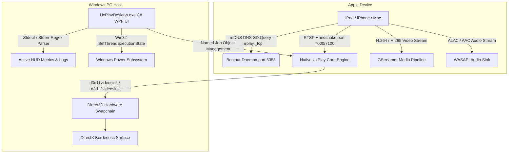

# 📺 UxPlay Desktop

<p align="center">
  <strong>Modern, Ultra-Low-Latency AirPlay Mirroring Client for Windows</strong><br>
  <em>Turn your Windows PC into a high-performance Apple AirPlay display and audio receiver.</em>
</p>

<p align="center">
  <a href="https://github.com/jorjanion/uxplay-desktop/releases/latest"></a>
  <a href="https://github.com/jorjanion/uxplay-desktop/blob/main/LICENSE"></a>
  
  
  
  
</p>

---

### 🌐 Read this documentation in your language:
[🇪🇸 Español](README.es.md) • [🇺🇸 English](README.md) • [🇫🇷 Français](README.fr.md) • [🇩🇪 Deutsch](README.de.md) • [🇮🇹 Italiano](README.it.md) • [🇧🇷 Português (Brasil)](README.pt.md) • [🇷🇺 Русский](README.ru.md) • [🇵🇱 Polski](README.pl.md) • [🇳🇱 Nederlands](README.nl.md) • [🇺🇦 Українська](README.uk.md) • [🇨🇳 简体中文](README.zh-CN.md) • [🇯🇵 日本語](README.ja.md)

---

## ⚡ Why UxPlay Desktop?

Many professionals, educators, and users who mirror an iPad or iPhone display for lectures, meetings, and presentations face frustrating issues:
- **Commercial AirPlay apps** charge expensive recurring subscriptions or show intrusive watermarks.
- **Older open-source tools** freeze on the first frame with recent iPadOS updates, require cumbersome command-line prompts, suffer from audio desync, or crash due to missing DLLs and D-Bus services.

**UxPlay Desktop** is built from the ground up to solve these problems permanently:
- **📦 1-Click Native Installer (`.exe`):** No dealing with zip files or manual extraction. Installs everything needed automatically.
- **🚀 100% Self-Contained:** Zero external dependencies required. .NET 8 desktop runtime, C++ runtimes, and GStreamer plugins are embedded.
- **⚡ Direct3D 11/12 Hardware Acceleration:** Ultra-fluid 60 FPS mirroring with crystal-clear text sharpness and sub-frame latency.
- **🖼️ Borderless Window Mode:** Clean, distraction-free display surface optimized for presentation projection and clear screen sharing.
- **🛡️ Automated Apple Bonjour & Firewall Configuration:** Automatically repairs dead or orphaned Bonjour services and opens AirPlay network ports.
- **🌍 15+ Native Languages:** Fluent interface with live, seamless language switching.
- **🔄 In-App Auto-Updates:** Detects new GitHub releases and updates cleanly in 1 click.

---

## 📖 Quick Start Guide (3-Step Setup)


### Step 1: Install the Application
1. Download **[`UxPlayDesktop-Setup.exe`](https://github.com/jorjanion/uxplay-desktop/releases/latest)** from the latest release.
2. Run the installer and follow the simple on-screen wizard.
3. The installer will automatically:
   - Install UxPlay Desktop into your Program Files.
   - Configure the Apple Bonjour discovery service.
   - Configure Windows Firewall rules so your Apple devices can connect without security blocks.
   - Optionally create a Desktop shortcut and enable launch on Windows startup.

### Step 2: Start the AirPlay Server
1. Launch **UxPlay Desktop** from your desktop or Start menu.
2. Click the big blue button: **"Start AirPlay Server"**.
3. The status indicator will turn blue and display: **"Ready to Connect"**.

### Step 3: Connect your iPad or iPhone
1. Ensure your iPad/iPhone and your Windows PC are connected to the **same Wi-Fi network**.
2. On your iPad or iPhone, swipe down from the top-right corner to open the **Control Center**.
3. Tap **Screen Mirroring** (the icon with two overlapping rectangles).
4. Select **"UxPlay Windows"** from the list.
5. Your screen will instantly appear on your PC monitor in high-definition 60 FPS!

### Understanding Streaming Presets
UxPlay Desktop comes with presets designed for specific tasks:
| Preset | Best For | What it Does |
| :--- | :--- | :--- |
| **🎓 Teaching & Presentations** *(Default)* | Presentations, lectures, whiteboard notes, and slides | Direct3D accelerated with maximum text clarity and automatic screensaver inhibition. |
| **🎮 Low Latency & Gaming** | Mobile gaming, drawing apps with immediate stylus response | Minimizes buffer latency for instantaneous 60 FPS feedback. |
| **🎬 High Quality Cinema** | Movies, YouTube, video playback | Adaptive jitter buffer prevents video stutter or artifacts. |
| **🎵 Audio Only** | Podcasts, Apple Music, Spotify | Streams pure lossless audio without opening a video window. |

---

## 🛠️ Troubleshooting

- **iPad doesn't see "UxPlay Windows" in Screen Mirroring?**
  1. Make sure both your PC and iPad/iPhone are on the **exact same Wi-Fi network** (not guest networks with client isolation).
  2. In UxPlay Desktop, go to the **Dashboard** and check the **Network Discovery (Apple Bonjour)** card. If it says *Stopped* or *Broken*, click **"Repair / Start Bonjour"** to fix it automatically.
- **Audio is slightly delayed compared to video?**
  - Go to **Settings > Audio Settings** and adjust the **Audio Sync Delay** slider (e.g. `+100 ms` or `-100 ms`) to compensate for Bluetooth speaker latency.

---

## 🔬 Technical Architecture & Internal Mechanics

For developers and contributors interested in the technical architecture and internal design:



### 1. AirPlay Protocol Stack & Core Engine
* **Source:** Derived from the active upstream master of [`FDH2/UxPlay`](https://github.com/FDH2/UxPlay) (v1.74).
* **Handshake & Crypto:** Handles FairPlay and modern iOS/iPadOS cryptographic key exchanges over RTSP (TCP port 7000/7100).
* **Zero D-Bus on Windows:** Upstream UxPlay relies on Linux D-Bus for screensaver inhibition (which crashes on Windows if `-scrsv` is passed). UxPlay Desktop intercepts power management and uses Win32 kernel API:
  ```csharp
  SetThreadExecutionState(EXECUTION_STATE.ES_CONTINUOUS | EXECUTION_STATE.ES_DISPLAY_REQUIRED | EXECUTION_STATE.ES_SYSTEM_REQUIRED);
  ```

### 2. GStreamer Direct3D Video Pipeline
* Video decoding uses hardware-accelerated **Direct3D 11 (`d3d11videosink`)** or **Direct3D 12 (`d3d12videosink`)**.
* Pipeline: `appsrc -> h264parse / h265parse -> d3d11h264dec / d3d11h265dec -> d3d11videosink`.
* Zero-copy buffer transfers ensure minimum CPU usage (< 3% on modern multi-core CPUs).

### 3. Windows Job Object Process Safety
* Subprocesses (`uxplay.exe` and Python Bluetooth LE beacon) are tied to a Win32 **Job Object** with `JOB_OBJECT_LIMIT_KILL_ON_JOB_CLOSE`.
* Even if the WPF application is terminated abruptly, the Windows kernel terminates all native child processes atomically, leaving no zombie ports open.

### 4. Apple Bonjour Service Auto-Recovery
* UxPlay communicates with Apple's `dnssd.dll`.
* If a previous third-party software left an orphaned `Bonjour Service` registered to a deleted directory, the discovery engine triggers automated elevation (`Verb = "runas"`) to cleanly re-register `mDNSResponder.exe` in `C:\Program Files\Bonjour` and open inbound UDP 5353 and TCP 7000-7100 in Windows Advanced Firewall.

---

## 🐛 Bug Reporting & Opening Issues

Found a bug or encountering connection issues? We welcome issue reports!

Please open an issue at **[GitHub Issues](https://github.com/jorjanion/uxplay-desktop/issues)** with:
1. **Operating System:** Windows 10 or 11 (build number).
2. **Apple Device:** iPad/iPhone model and iOS/iPadOS version (e.g. iPad Pro 11" M2, iPadOS 18.1).
3. **Log Output:** Go to the **Real-time Logs** tab inside UxPlay Desktop, click **"Copy All"**, and paste the relevant log excerpt.
4. **Network Setup:** Whether both devices are on 2.4GHz, 5GHz, Ethernet, or mesh router.

---

## 🤝 Contributing & Pull Requests

Pull requests are **warmly welcomed**!

Before submitting a PR, please review our contribution philosophy:
1. **Value Addition:** PRs should tangibly improve performance, resolve known bugs, or enhance usability for educators and streamers.
2. **Zero-Cost Constraint:** This project is strictly **100% Free & Open Source (€0 budget)**. Never introduce proprietary SDKs, paid cloud services, or closed-source libraries.
3. **Creator Comprehension:** Please write clear, readable commit messages and PR descriptions explaining *what* was changed and *why*, so the maintainer can easily review and understand every line of code.
4. **Test Integrity:** All automated unit tests in `tests/UxPlayDesktop.Tests` must pass (`powershell .\build.ps1 -Action test`).

---

## 📜 License & Credits

* **UxPlay Desktop** is licensed under the **[GNU General Public License v3.0 (GPL-3.0)](LICENSE)**.
* Built upon the open-source native engine by **[FDH2/UxPlay](https://github.com/FDH2/UxPlay)**.
* Developed and maintained with ❤️ by **jorjanion**.
