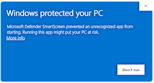

# 📺 UxPlay Desktop (简体中文)

  

  <strong>现代化、超低延迟的 Windows AirPlay 屏幕镜像接收端</strong> 
  <em>将任意 Windows 电脑秒变 iPad、iPhone 和 Mac 的高性能无线投屏显示器与音频接收器。</em>

---

### 🌐 阅读其他语言版本文档：
[🇪🇸 Español](README.es.md) • [🇺🇸 English](README.md) • [🇫🇷 Français](README.fr.md) • [🇩🇪 Deutsch](README.de.md) • [🇮🇹 Italiano](README.it.md) • [🇧🇷 Português (Brasil)](README.pt.md) • [🇷🇺 Русский](README.ru.md) • [🇵🇱 Polski](README.pl.md) • [🇳🇱 Nederlands](README.nl.md) • [🇺🇦 Українська](README.uk.md) • [🇨🇳 简体中文](README.zh-CN.md) • [🇯🇵 日本語](README.ja.md)

---

## ⚡ 核心优势

- **📦 一键安装包 (.exe)：** 告别繁琐的 ZIP 压缩包与手动提取，安装程序自动配置全套运行环境。
- **🚀 100% 独立内置 (Self-Contained)：** 零外部运行库依赖，已内置 .NET 8 桌面引擎、C++ 依赖与 GStreamer 解码插件。
- **⚡ Direct3D 11/12 GPU 硬件加速：** 60 帧丝滑镜像，GoodNotes 与 Notability 书写笔迹极度锐利，超低延迟。
- **💬 Discord 与 OBS 专属助手：** 无边框窗口模式，专为网课直播、网课白板与课件分享深度优化。
- **🛡️ Bonjour 服务与防火墙自动修复：** 自动清理旧版本损坏的服务注册，自动开放 Windows 防火墙投屏端口。
- **🌍 超过 15 种多国语言：** 界面无缝即时切换。

---

## 📖 3 步快速上手

1. **下载安装：** 下载并运行 **[`UxPlayDesktop-Setup.exe`](https://github.com/jorjanion/uxplay-desktop/releases/latest)** 安装包。
2. **启动服务：** 打开软件，点击蓝色的 **“启动 AirPlay 服务”** 按钮，状态变为 *“等待设备连接”*。
3. **连接设备：** 确保电脑与 iPad/iPhone 连接在 **同一 Wi-Fi 网络** 下；在苹果设备上滑出 **控制中心** > 点击 **屏幕镜像** > 选择 **“UxPlay Windows”**。
4. **Discord / OBS 投屏：** 进入 Discord 语音频道 > 点击屏幕共享 > 选择“应用程序”下的 **“UxPlay Windows”** 即可。

---

## 🐛 反馈与共建

如遇 Bug 或无法连接，欢迎前往 **[GitHub Issues](https://github.com/jorjanion/uxplay-desktop/issues)** 提交反馈。
Pull Request 随时欢迎（要求遵守 0 元开源承诺、代码简洁可读并附带说明）。

---

## 📜 开源协议

本项目基于 **GNU General Public License v3.0 (GPL-3.0)** 协议完全免费开源。
开发者：**Jorge Paris**。
