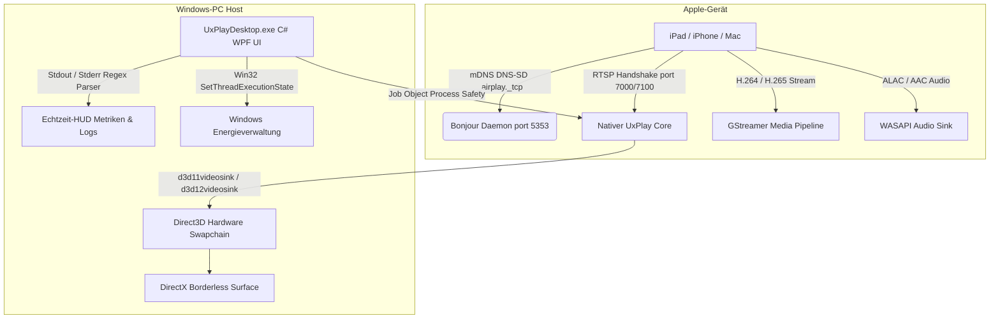

# 📺 UxPlay Desktop (Deutsch)

  <strong>Moderne AirPlay-Bildschirmspiegelung mit extrem geringer Latenz für Windows</strong> 
  <em>Verwandelt jeden Windows-PC in einen leistungsstarken Apple AirPlay-Empfänger für iPad, iPhone und Mac.</em>

  
  
  
  
  
  

---

### 🌐 Diese Dokumentation in anderen Sprachen lesen:
[🇪🇸 Español](README.es.md) • [🇺🇸 English](../../README.md) • [🇫🇷 Français](README.fr.md) • [🇩🇪 Deutsch](README.de.md) • [🇮🇹 Italiano](README.it.md) • [🇧🇷 Português (Brasil)](README.pt.md) • [🇷🇺 Русский](README.ru.md) • [🇵🇱 Polski](README.pl.md) • [🇳🇱 Nederlands](README.nl.md) • [🇺🇦 Українська](README.uk.md) • [🇨🇳 简体中文](README.zh-CN.md) • [🇯🇵 日本語](README.ja.md)

---

## ⚡ Warum UxPlay Desktop?

Lehrende, Dozenten und Profis, die den Bildschirm ihres iPads oder iPhones in Vorlesungen und Meetings spiegeln, stoßen oft auf bekannte Hürden:
- **Kommerzielle AirPlay-Programme** verlangen teure Abonnements oder blenden störende Wasserzeichen ein.
- **Ältere Open-Source-Tools** frieren unter aktuellen iPadOS-Versionen ein, erfordern umständliche Konsolenbefehle, leiden unter Audio-Asynchronität oder scheitern an fehlenden DLL-Bibliotheken.

**UxPlay Desktop** wurde von Grund auf entwickelt, um diese Probleme dauerhaft zu lösen:

**📦 Nativer 1-Klick-Installer (`.exe`):** Kein manuelles Entpacken von ZIP-Dateien mehr. Einfach die Setup-Datei ausführen und alles ist startbereit.
**🚀 100% Autark (Self-Contained):** Keine externe .NET-Installation nötig; .NET 8 Runtime, C++ Bibliotheken und GStreamer-Plugins sind vollständig integriert.
**⚡ Direct3D 11/12 Hardwarebeschleunigung:** Kristallklare 60 FPS Darstellung, gestochen scharfe Stiftführung in Notizen-Apps und minimale Eingabelatenz.
**🖼️ Rahmenloser Fenstermodus:** Störungsfreie Darstellung, ideal für Präsentationen und Bildschirmfreigaben.
**🛡️ Automatische Bonjour- & Firewall-Reparatur:** Erkennt fehlerhafte mDNS-Dienste, richtet Apple Bonjour neu ein und öffnet erforderliche Ports in der Windows-Firewall.
**🌍 In über 15 Sprachen verfügbar:** Deutsch, Englisch, Spanisch, Französisch, Portugiesisch, Russisch, Chinesisch, Japanisch und mehr mit sofortigem Sprachwechsel.
**🔄 1-Klick Auto-Updates:** Informiert über neue Versionen und aktualisiert die Anwendung vollautomatisch.

---

## 📖 Schnellstartanleitung (3 einfache Schritte)

### Schritt 1: Programm installieren
1. Laden Sie **[`UxPlayDesktop-Setup.exe`](https://github.com/jorjanion/uxplay-desktop/releases/latest)** herunter.
2. Führen Sie die Installation aus und folgen Sie den Bildschirmanweisungen.
3. Das Installationsprogramm richtet automatisch UxPlay Desktop, den Bonjour-Dienst und die Firewall-Regeln ein.

### Schritt 2: AirPlay-Server starten
1. Starten Sie **UxPlay Desktop** über den Desktop oder das Startmenü.
2. Klicken Sie auf die blaue Schaltfläche **"AirPlay Server Starten"**.
3. Der Status wechselt auf Blau: **"Bereit zum Verbinden"**.

### Schritt 3: iPad oder iPhone verbinden
1. Stellen Sie sicher, dass sich PC und Apple-Gerät im **selben WLAN-Netzwerk** befinden.
2. Öffnen Sie auf dem iPad oder iPhone das **Kontrollzentrum**.
3. Tippen Sie auf **Bildschirmsynchronisierung** (zwei überlappende Rechtecke).
4. Wählen Sie **"UxPlay Windows"** aus der Liste aus.
5. Ihr Bildschirm erscheint sofort in flüssigen 60 FPS auf Ihrem Windows-Monitor.

### Streaming-Profile & Voreinstellungen
| Profil | Empfohlen für | Funktionsweise |
| :--- | :--- | :--- |
| **🎓 Unterricht & Präsentationen** *(Standard)* | Vorlesungen, Folien, digitale Tafel | Maximale Textschärfe, Direct3D-Beschleunigung und Standby-Sperre gegen Bildschirmabschaltung. |
| **🎮 Geringe Latenz & Gaming** | Zeichnen mit Stift, mobile Spiele | Minimaler Puffer für unverzögerte 60 FPS Reaktion. |
| **🎬 Kino & HD-Video** | Filme, YouTube, Videowiedergabe | Adaptiver Jitter-Puffer gegen Ruckler und Bildartefakte. |
| **🎵 Nur Audio** | Musik, Podcasts, Apple Music | Schaltet die Videoanzeige ab und überträgt verlustfreies ALAC-Audio ressourcenschonend. |

---

## 🛠️ Fehlerbehebung & Häufige Fragen

**Das iPad findet "UxPlay Windows" nicht in der Bildschirmsynchronisierung?**
  1. Vergewissern Sie sich, dass beide Geräte im **selben WLAN** sind (Gäste-Netzwerke mit Client-Isolation vermeiden).
  2. Prüfen Sie in UxPlay Desktop auf der Hauptseite die Karte **Netzwerkerkennung (Apple Bonjour)**. Klicken Sie bei Bedarf auf **"Bonjour Reparieren / Starten"**.
**Audio und Video laufen leicht asynchron?**
  - Öffnen Sie **Einstellungen > Audio-Einstellungen** und justieren Sie den Schieberegler **Audio-Synchronisationsverzögerung** (z. B. `+100 ms` oder `-100 ms`).

---

## 🔬 Technische Architektur & Funktionsweise

Für Entwickler und Mitwirkende, die das technische Fundament verstehen möchten:

### 1. AirPlay-Protokollstack & Nativer Core
* **Basis:** Basierend auf dem Upstream-Master von [`FDH2/UxPlay`](https://github.com/FDH2/UxPlay) (Version 1.74).
* **FairPlay-Krypto & Handshake:** Bewältigt den kryptografischen Schlüsselaustausch moderner iOS/iPadOS-Versionen über RTSP (Ports 7000/7100).
* **Kein Linux-D-Bus unter Windows:** Nutzt anstelle von D-Bus die native Win32-Kernel-API `SetThreadExecutionState` zur Standby-Verhinderung.

### 2. GStreamer Direct3D Video-Pipeline
* Hardwarebeschleunigte Dekodierung über **Direct3D 11 (`d3d11videosink`)** und Direct3D 12.
* Pipeline: `appsrc -> h264parse / h265parse -> d3d11h264dec / d3d11h265dec -> d3d11videosink`.
* Zero-Copy GPU-Speicherübertragung mit minimaler CPU-Last (< 3%).

### 3. Prozesssicherheit durch Windows Job Objects
* Native Subprozesse sind an ein Win32 **Job Object** mit `JOB_OBJECT_LIMIT_KILL_ON_JOB_CLOSE` gebunden.
* Bei Beendigung der Benutzeroberfläche schließt der Windows-Kernel automatisch alle Kindprozesse atomar.

### 4. Apple Bonjour Auto-Reparatur
* Direkte Anbindung an Apples `dnssd.dll`.
* Repariert verwaiste Registrierungseinträge von `mDNSResponder.exe` in `C:\Program Files\Bonjour` und öffnet Port UDP 5353 sowie TCP 7000-7100 in der Firewall.

---

## 🐛 Fehler Melden & Issues Erstellen

Haben Sie einen Fehler entdeckt? Wir freuen uns über Ihren Bericht!

Erstellen Sie bitte ein Issue unter **[GitHub Issues](https://github.com/jorjanion/uxplay-desktop/issues)** mit folgenden Angaben:
1. **Betriebssystem:** Windows 10 oder 11 (Build-Nummer).
2. **Apple-Gerät:** iPad/iPhone-Modell und iOS/iPadOS-Version.
3. **Logs:** Wechseln Sie in den Reiter **Echtzeit-Logs**, klicken Sie auf **"Kopieren"** und fügen Sie den Auszug ein.
4. **Netzwerk:** WLAN 2.4/5GHz, LAN oder Mesh-Netzwerk.

---

## 🤝 Mitwirken & Pull Requests (PRs)

Pull Requests sind **herzlich willkommen**!

Leitlinien für Beiträge:
1. **Echter Mehrwert:** PRs sollten messbare Verbesserungen (Leistung, Stabilität, Zugänglichkeit) bringen.
2. **Null-Kosten-Grenze (€0):** Streng 100% frei und Open Source. Keine proprietären SDKs oder kostenpflichtigen Cloud-Dienste.
3. **Verständlichkeit:** Bitte Änderungen in der Beschreibung nachvollziehbar erklären, damit der Maintainer den Code prüfen kann.
4. **Testabdeckung:** Alle Unit-Tests in `tests/UxPlayDesktop.Tests` müssen erfolgreich durchlaufen.

---

## 📜 Lizenz & Danksagung

* **UxPlay Desktop** steht unter der **[GNU General Public License v3.0 (GPL-3.0)](LICENSE)**.
* Baut auf dem Open-Source-Projekt von **[FDH2/UxPlay](https://github.com/FDH2/UxPlay)** auf.
* Entwickelt und gepflegt mit ❤️ von **jorjanion**.
