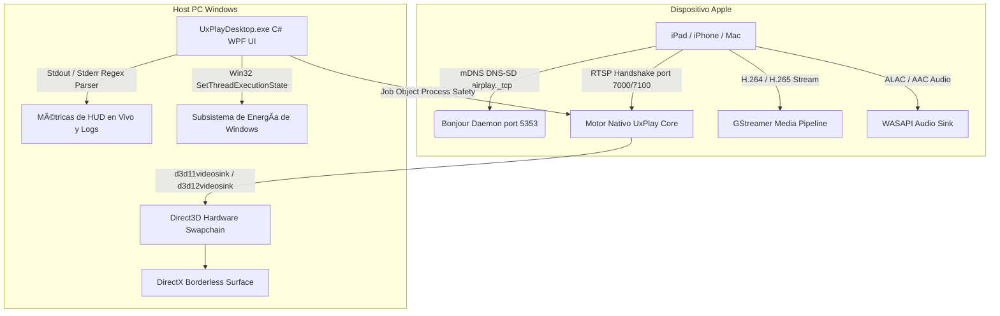

# 📺 UxPlay Desktop (Español)

  <strong>Cliente de duplicado de pantalla AirPlay moderno y de ultra-baja latencia para Windows</strong> 
  <em>Convierte cualquier ordenador con Windows en un receptor AirPlay de alto rendimiento para iPad, iPhone y Mac.</em>

  
  
  
  
  
  

---

### 🌐 Leer esta documentación en otros idiomas:
[🇪🇸 Español](README.es.md) • [🇺🇸 English](../../README.md) • [🇫🇷 Français](README.fr.md) • [🇩🇪 Deutsch](README.de.md) • [🇮🇹 Italiano](README.it.md) • [🇧🇷 Português (Brasil)](README.pt.md) • [🇷🇺 Русский](README.ru.md) • [🇵🇱 Polski](README.pl.md) • [🇳🇱 Nederlands](README.nl.md) • [🇺🇦 Українська](README.uk.md) • [🇨🇳 简体中文](README.zh-CN.md) • [🇯🇵 日本語](README.ja.md)

---

## ⚡ ¿Por qué UxPlay Desktop?

Muchos profesionales, docentes y usuarios que comparten la pantalla de su iPad o iPhone en presentaciones y reuniones se topan con problemas continuos:
- **Las aplicaciones comerciales de AirPlay** exigen suscripciones mensuales caras, cuotas de renovación o estampan marcas de agua molestas en mitad de la pantalla.
- **Otras herramientas libres antiguas** se congelan en el primer fotograma con las últimas versiones de iPadOS, requieren comandos técnicos raros por consola, sufren desincronización de audio o fallan por falta de librerías DLL y servicios de Linux.

**UxPlay Desktop** ha sido diseñado desde cero para solucionar todo esto de forma definitiva:

- **📦 Instalador Nativo Directo (`.exe`):** Olvídate de descomprimir zips ni lidiar con carpetas. Descargas el instalador, pulsas Siguiente y te lo deja todo listo.
- **🚀 100% Autónomo (Self-Contained):** No te pedirá descargar .NET ni componentes externos; incluye el motor de .NET 8, librerías C++ y plugins de GStreamer en su propio ejecutable.
- **⚡ Aceleración Direct3D 11/12 por Hardware:** 60 FPS ultra fluidos, nitidez absoluta en los trazos de GoodNotes y Notability y latencia imperceptible.
- **🖼️ Modo Ventana sin Bordes:** Visualización limpia y optimizada para proyecciones y captura fluida de pantalla sin distracciones ni marcos molestos.
- **🛡️ Reparación y Configuración Automática de Bonjour y Firewall:** Detecta servicios rotos de versiones antiguas, reconfigura Apple Bonjour en un clic y abre los puertos de red en el Firewall de Windows para que el iPad lo detecte al instante.
- **🌍 Traducido a más de 15 idiomas:** Español, inglés, francés, alemán, portugués, ruso, chino, japonés y más, con cambio dinámico al instante.
- **🔄 Actualizaciones en 1 Clic:** La app te avisa si hay una nueva versión y te la actualiza automáticamente con un solo clic.

---

## 📖 Guía Rápida para Usuarios (Puesta en Marcha en 3 Pasos)

### Paso 1: Instalar el Programa
1. Descarga el instalador **[`UxPlayDesktop-Setup.exe`](https://github.com/jorjanion/uxplay-desktop/releases/latest)** de la última versión.
2. Abre el instalador y sigue las sencillas instrucciones en pantalla.
3. El instalador se encargará automáticamente de instalar la aplicación, registrar el servicio Bonjour y habilitar las excepciones en el Firewall de Windows.

### Paso 2: Iniciar el Servidor AirPlay
1. Abre **UxPlay Desktop** desde tu Escritorio o el menú Inicio.
2. Pulsa el botón azul **"Iniciar Servidor AirPlay"**.
3. El indicador cambiará a color azul con el mensaje: **"Listo para Conectar"**.

### Paso 3: Conectar tu iPad o iPhone
1. Comprueba que tu iPad/iPhone y tu PC con Windows están conectados a la **misma red Wi-Fi**.
2. En tu iPad o iPhone, desliza el dedo desde la esquina superior derecha para abrir el **Centro de Control**.
3. Toca en **Duplicar pantalla** (el icono de los dos rectángulos superpuestos).
4. Elige **"UxPlay Windows"** en la lista.
5. ¡Listo! La pantalla de tu iPad aparecerá al instante en tu monitor a 60 FPS sin retraso.

### Perfiles de Rendimiento (Presets Explicados)
| Perfil | Recomendado para | ¿Qué hace? |
| :--- | :--- | :--- |
| **🎓 Clases y Presentaciones** *(Por defecto)* | Docencia, presentaciones, pizarra digital y diapositivas | Máxima nitidez de texto, aceleración Direct3D y bloqueo automático del salvapantallas para que la pantalla no se apague en clase. |
| **🎮 Baja Latencia y Juegos** | Dibujo rápido, juegos de iPad | Búfer reducido al mínimo para conseguir respuesta inmediata en cada trazo a 60 FPS. |
| **🎬 Cine y Vídeo HD** | Películas, YouTube, multimedia | Búfer adaptativo contra tirones para reproducir vídeo sin artefactos. |
| **🎵 Solo Audio** | Música, podcasts, Apple Music | Apaga el vídeo para ahorrar recursos y transmite audio ALAC de alta fidelidad. |

---

## 🛠️ Preguntas Frecuentes y Solución de Problemas

- **¿El iPad o iPhone no detecta "UxPlay Windows" en Duplicar Pantalla?**
  1. Asegúrate de que ambos dispositivos están conectados a la **misma red Wi-Fi** (ojo con redes de invitados con aislamiento de clientes activado).
  2. En UxPlay Desktop, ve al panel principal y mira la tarjeta **Descubrimiento en Red (Apple Bonjour)**. Si dice *Detenido* o *Roto*, pulsa el botón **"Reparar / Iniciar Bonjour"** para que lo configure automáticamente como Administrador.
- **¿El audio va ligeramente desfasado con el vídeo?**
  - Ve a la pestaña **Ajustes > Ajustes de Audio** y mueve el control deslizante **Calibración de Sincronización** (por ejemplo `+100 ms` o `-100 ms`) para compensar el retardo de auriculares Bluetooth.

---

## 🔬 Arquitectura Técnica y Funcionamiento Interno

Para desarrolladores y colaboradores interesados en la arquitectura técnica y el diseño interno:

### 1. Protocolo AirPlay y Motor Nativo
* **Núcleo:** Basado en la rama activa master de [`FDH2/UxPlay`](https://github.com/FDH2/UxPlay) (versión 1.74).
* **Criptografía FairPlay y Handshake:** Resuelve los intercambios de claves de iOS/iPadOS 17/18/19 mediante negociación RTSP (puertos TCP 7000/7100).
* **Eliminación de D-Bus en Windows:** La versión original de Linux usa D-Bus para el salvapantallas. UxPlay Desktop intercepta la gestión de energía mediante la API nativa de Windows `SetThreadExecutionState`.

### 2. Pipeline de Vídeo Direct3D en GStreamer
* Decodificación acelerada por GPU mediante **Direct3D 11 (`d3d11videosink`)** y Direct3D 12.
* Pipeline: `appsrc -> h264parse / h265parse -> d3d11h264dec / d3d11h265dec -> d3d11videosink`.
* Renderizado zero-copy de memoria GPU con consumo de CPU inferior al 3% en procesadores multinúcleo.

### 3. Seguridad de Procesos con Job Objects de Windows
* Los subprocesos nativos (`uxplay.exe` y balizas Bluetooth LE) están asignados a un **Job Object** de Windows con el flag `JOB_OBJECT_LIMIT_KILL_ON_JOB_CLOSE`.
* Si la interfaz WPF se cierra o cae, el kernel de Windows liquida todos los procesos hijos de forma atómica, evitando procesos zombie o puertos bloqueados.

### 4. Recuperación y Reparación Automática de Apple Bonjour
* UxPlay se comunica con la biblioteca `dnssd.dll` de Apple.
* Si instalaciones previas de otros programas dejaron un servicio corrupto o huérfano, el motor de diagnóstico reinstala y registra limpiamente `mDNSResponder.exe` en `C:\Program Files\Bonjour`, abriendo automáticamente los puertos UDP 5353 y TCP 7000-7100 en el Firewall de Windows.

---

## 🐛 Reportar Errores y Abrir Issues

¿Has encontrado un fallo o problema de conexión? ¡Tu reporte nos ayuda a mejorar!

Por favor, abre una incidencia en **[GitHub Issues](https://github.com/jorjanion/uxplay-desktop/issues)** incluyendo:
1. **Sistema Operativo:** Windows 10 u 11 (número de compilación).
2. **Dispositivo Apple:** Modelo de iPad/iPhone y versión de iOS/iPadOS (ej. iPad Pro M2, iPadOS 18.1).
3. **Registro de Logs:** Ve a la pestaña **Logs en Tiempo Real** dentro de UxPlay Desktop, pulsa **"Copiar"** y pega las líneas relevantes.
4. **Tipo de Conexión:** Si usas Wi-Fi 2.4GHz, 5GHz, cable de red o router mesh.

---

## 🤝 Cómo Colaborar y Enviar Pull Requests (PRs)

¡Las contribuciones y Pull Requests son **muy bien recibidas**!

Antes de abrir una PR, ten en cuenta nuestra filosofía:
1. **Aporte Real:** La PR debe aportar una mejora medible (rendimiento, corrección de bugs, estabilidad o accesibilidad para profesores y usuarios).
2. **Presupuesto Cero (€0):** Este proyecto es estrictamente **100% Libre y de Código Abierto**. Jamás se aceptarán dependencias de pago, servicios cloud de suscripción o librerías privativas.
3. **Comprensión del Creador:** Explica claramente en la descripción de la PR *qué* has cambiado y *por qué*. Es fundamental que el creador del repositorio entienda cada línea de código aportada.
4. **Calidad y Tests:** Todo el conjunto de pruebas unitarias en `tests/UxPlayDesktop.Tests` debe compilar y pasar limpiamente (`powershell .\build.ps1 -Action test`).

---

## 📜 Licencia y Agradecimientos

* **UxPlay Desktop** está publicado bajo la licencia **[GNU General Public License v3.0 (GPL-3.0)](LICENSE)**.
* Basado en el excelente trabajo original de ingeniería inversa de **[FDH2/UxPlay](https://github.com/FDH2/UxPlay)**.
* Diseñado y mantenido con ❤️ por **jorjanion**.

