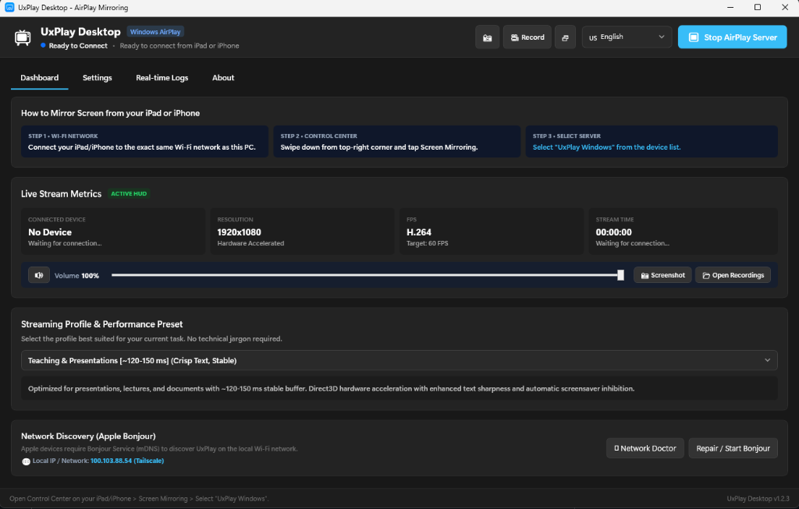
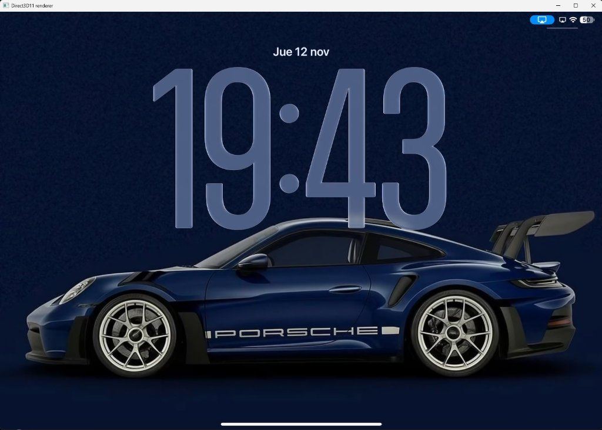

</p>

<p align="center">
  
</p>

<p align="center">
  
</p>

--- 📺 UxPlay Desktop (Français)

<p align="center">
  <strong>Client de recopie d'écran AirPlay moderne et à ultra-faible latence pour Windows</strong><br>
  <em>Transformez n'importe quel PC Windows en un récepteur AirPlay haute performance pour iPad, iPhone et Mac.</em>
</p>

<p align="center">
  <a href="https://github.com/jorjanion/uxplay-desktop/releases/latest"></a>
  <a href="https://github.com/jorjanion/uxplay-desktop/blob/main/LICENSE"></a>
  
  
  
  
</p>

---

### 🌐 Lire cette documentation dans une autre langue:
[🇪🇸 Español](README.es.md) • [🇺🇸 English](../../README.md) • [🇫🇷 Français](README.fr.md) • [🇩🇪 Deutsch](README.de.md) • [🇮🇹 Italiano](README.it.md) • [🇧🇷 Português (Brasil)](README.pt.md) • [🇷🇺 Русский](README.ru.md) • [🇵🇱 Polski](README.pl.md) • [🇳🇱 Nederlands](README.nl.md) • [🇺🇦 Українська](README.uk.md) • [🇨🇳 简体中文](README.zh-CN.md) • [🇯🇵 日本語](README.ja.md)

---

## âš¡ Pourquoi UxPlay Desktop ?

De nombreux enseignants, formateurs et professionnels qui partagent l'écran de leur iPad ou iPhone sont confrontés à des blocages récurrents :
- **Les applications AirPlay commerciales** imposent des abonnements mensuels onéreux ou apposent des filigranes intrusifs.
- **Les anciens outils open source** se figent dès la première image avec les versions récentes d'iPadOS, requièrent des commandes complexes dans le terminal, souffrent de désynchronisation audio ou échouent par manque de bibliothèques DLL.

**UxPlay Desktop** a été conçu pour résoudre définitivement ces désagréments :

- **📦 Installateur Natif (.exe) en 1 Clic :** Fini les archives ZIP à décompresser manuellement. Téléchargez l'exécutable, suivez l'assistant et tout est prêt.
- **🚀 100% Autonome (Self-Contained) :** N'exige aucun téléchargement externe ; intègre le runtime .NET 8, les DLL C++ et les plugins GStreamer.
- **⚡ Accélération Matérielle Direct3D 11/12 :** Débit fluide de 60 FPS, netteté parfaite des notes manuscrites et latence imperceptible.
- **🖼️ Mode Fenêtre sans Bordure :** Affichage épuré idéal pour la vidéoprojection et le partage d'écran sans distractions.
- **🛡️ Réparation Automatique Bonjour & Pare-feu :** Détecte les services mDNS corrompus, reconfigure Apple Bonjour et ouvre les ports réseau dans le Pare-feu Windows.
- **🌍 Disponible en plus de 15 langues :** Français, anglais, espagnol, allemand, portugais, russe, chinois, japonais et bien d'autres.
- **🔄 Mises à Jour en 1 Clic :** Détection automatique des nouvelles versions GitHub et mise à niveau transparente.

---

## 📖 Guide de Démarrage Rapide (3 Étapes)

### Étape 1 : Installer l'Application
1. Téléchargez l'installateur **[`UxPlayDesktop-Setup.exe`](https://github.com/jorjanion/uxplay-desktop/releases/latest)**.
2. Lancez l'installation et suivez l'assistant.
3. L'installateur installe automatiquement le programme, configure le service Bonjour et ouvre les ports de sécurité Windows.

### Étape 2 : Démarrer le Serveur AirPlay
1. Ouvrez **UxPlay Desktop** depuis votre Bureau ou le menu Démarrer.
2. Cliquez sur le bouton bleu **« Démarrer le Serveur AirPlay »**.
3. L'indicateur s'allume en bleu avec le message : **« Prêt à connecter »**.

### Étape 3 : Connecter votre iPad ou iPhone
1. Assurez-vous que votre appareil Apple et votre PC sont sur le **même réseau Wi-Fi**.
2. Sur votre iPad ou iPhone, ouvrez le **Centre de contrôle**.
3. Touchez **Recopie de l'écran** (l'icône avec deux rectangles imbriqués).
4. Sélectionnez **« UxPlay Windows »** dans la liste.
5. Votre écran s'affiche immédiatement sur votre moniteur en haute définition 60 FPS sans décalage.

### Profils de Diffusion (Préréglages Expliqués)
| Profil | Recommandé pour | Description |
| :--- | :--- | :--- |
| **🎓 Enseignement & Présentations** *(Défaut)* | Cours, diapositives, prise de notes numérique | Clarté de texte maximale, Direct3D et inhibition automatique de mise en veille d'écran. |
| **🎮 Faible Latence & Jeux** | Dessin au stylet, jeux mobiles réactifs | Mémoire tampon minimale pour un retour tactile instantané à 60 FPS. |
| **🎬 Cinéma & Vidéo HD** | Films, YouTube, multimédia | Tampon adaptatif évitant les saccades et garantissant une lecture fluide. |
| **🎵 Audio Uniquement** | Musique, podcasts, Apple Music | Désactive le flux vidéo pour économiser les ressources et diffuser en audio ALAC sans perte. |

---

## 🛠️ Dépannage & Questions Fréquentes

- **L'iPad ne détecte pas "UxPlay Windows" dans la recopie d'écran ?**
  1. Vérifiez que les deux appareils sont sur le **même réseau Wi-Fi** (attention aux réseaux invités avec isolation des clients).
  2. Dans UxPlay Desktop, vérifiez la carte **Découverte Réseau (Apple Bonjour)**. Si l'état indique *Arrêté*, cliquez sur **« Réparer / Démarrer Bonjour »**.
- **Le son a un léger décalage par rapport à la vidéo ?**
  - Rendez-vous dans **Paramètres > Paramètres Audio** et ajustez le curseur **Délai de Synchronisation Audio** (par exemple `+100 ms` ou `-100 ms`).

---

## 🔬 Architecture Technique & Fonctionnement Interne

Pour les développeurs et contributeurs souhaitant explorer les rouages techniques :

```mermaid
graph TD
    subgraph Appareil Apple
        A[iPad / iPhone / Mac] -->|mDNS DNS-SD _airplay._tcp| B(Bonjour Daemon port 5353)
        A -->|RTSP Handshake port 7000/7100| C[Moteur Natif UxPlay Core]
        A -->|H.264 / H.265 Stream| D[GStreamer Media Pipeline]
        A -->|ALAC / AAC Audio| E[WASAPI Audio Sink]
    end

    subgraph Hôte PC Windows
        C -->|d3d11videosink / d3d12videosink| F[Direct3D Hardware Swapchain]
        F --> G[DirectX Borderless Surface]
        H[UxPlayDesktop.exe C# WPF UI] -->|Job Object Process Safety| C
        H -->|Stdout / Stderr Regex Parser| I[Métriques HUD & Journaux]
        H -->|Win32 SetThreadExecutionState| J[Sous-système d'Alimentation Windows]
    end
```

### 1. Pile Protocolaire AirPlay & Moteur Natif
* **Base :** Dérivé de la branche master de [`FDH2/UxPlay`](https://github.com/FDH2/UxPlay) (v1.74).
* **Cryptographie FairPlay :** Prise en charge des échanges de clés iOS/iPadOS 17/18 via négociation RTSP (ports 7000/7100).
* **Zéro D-Bus sous Windows :** Remplacement de D-Bus par l'API Win32 `SetThreadExecutionState` pour empêcher la mise en veille pendant les présentations.

### 2. Pipeline Vidéo Direct3D GStreamer
* Décodage GPU accéléré par **Direct3D 11 (`d3d11videosink`)** et Direct3D 12.
* Pipeline : `appsrc -> h264parse / h265parse -> d3d11h264dec / d3d11h265dec -> d3d11videosink`.
* Rendu sans copie en mémoire GPU avec consommation CPU inférieure à 3%.

### 3. Sécurité des Processus via Windows Job Objects
* Les sous-processus natifs sont rattachés à un **Job Object** Win32 avec `JOB_OBJECT_LIMIT_KILL_ON_JOB_CLOSE`.
* En cas de fermeture imprévue de l'interface, le système Windows termine automatiquement tous les processus enfants pour éviter les ports orphelins.

### 4. Auto-Réparation du Service Apple Bonjour
* Liaison directe avec `dnssd.dll`.
* En cas de service mDNS corrompu, le moteur réinscrit proprement `mDNSResponder.exe` dans `C:\Program Files\Bonjour` et configure les autorisations de pare-feu correspondantes.

---

## 🐛 Signaler un Bug & Ouvrir une Issue

Vous avez repéré un bogue ? Vos retours sont précieux !

Ouvrez une issue sur **[GitHub Issues](https://github.com/jorjanion/uxplay-desktop/issues)** en mentionnant :
1. **Système d'exploitation :** Windows 10 ou 11 (version exacte).
2. **Appareil Apple :** Modèle d'iPad/iPhone et version iPadOS/iOS.
3. **Journaux :** Allez dans l'onglet **Journaux en Temps Réel**, cliquez sur **« Copier »** et collez les lignes pertinentes.
4. **Type de réseau :** Wi-Fi 2.4/5GHz, câble ou répéteur mesh.

---

## 🤝 Contribuer & Proposer des Pull Requests (PR)

Les contributions sont **chaleureusement accueillies** !

Principes directeurs :
1. **Apport Mesurable :** Les PR doivent apporter une amélioration tangible (performances, stabilité, ergonomie).
2. **Budget Zéro (€0) :** Projet 100% libre et gratuit. Aucun service payant ou composant propriétaire n'est accepté.
3. **Clarté :** Détaillez clairement les modifications apportées afin que le mainteneur puisse aisément comprendre le code soumis.
4. **Tests Unitaires :** L'ensemble des 39 tests de `tests/UxPlayDesktop.Tests` doit réussir sans avertissement.

---

## 📜 Licence & Remerciements

* **UxPlay Desktop** est distribué sous licence **[GNU General Public License v3.0 (GPL-3.0)](LICENSE)**.
* Conçu sur les bases du moteur open source de **[FDH2/UxPlay](https://github.com/FDH2/UxPlay)**.
* Développé et maintenu avec ❤️ par **jorjanion**.

