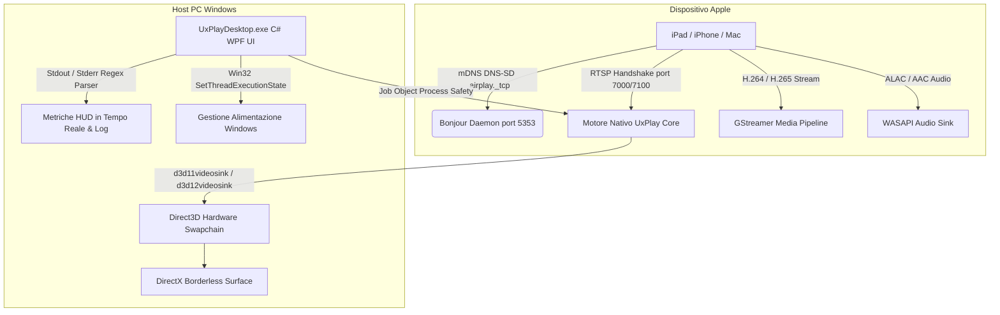

# 📺 UxPlay Desktop (Italiano)

  <strong>Client di duplicazione dello schermo AirPlay moderno e ad ultra-bassa latenza per Windows</strong> 
  <em>Trasforma qualsiasi PC Windows in un ricevitore Apple AirPlay ad alte prestazioni per iPad, iPhone e Mac.</em>

  
  
  
  
  
  

---

### 🌐 Leggi questa documentazione in un'altra lingua:
[🇪🇸 Español](README.es.md) • [🇺🇸 English](../../README.md) • [🇫🇷 Français](README.fr.md) • [🇩🇪 Deutsch](README.de.md) • [🇮🇹 Italiano](README.it.md) • [🇧🇷 Português (Brasil)](README.pt.md) • [🇷🇺 Русский](README.ru.md) • [🇵🇱 Polski](README.pl.md) • [🇳🇱 Nederlands](README.nl.md) • [🇺🇦 Українська](README.uk.md) • [🇨🇳 简体中文](README.zh-CN.md) • [🇯🇵 日本語](README.ja.md)

---

## ⚡ Perché UxPlay Desktop?

Molti insegnanti, relatori e professionisti che condividono lo schermo di iPad o iPhone affrontano problemi continui:
- **Le app AirPlay commerciali** impongono costosi abbonamenti o applicano filigrane visive invasive.
- **I vecchi strumenti open source** si bloccano al primo fotogramma con le versioni recenti di iPadOS, richiedono comandi complessi da terminale o soffrono di desincronizzazione audio.

**UxPlay Desktop** è stato sviluppato per risolvere definitivamente ogni criticità:

- **📦 Installer Nativo (.exe) in 1 Clic:** Nessun file ZIP da estrarre manualmente. Esegui il file di installazione e tutto è configurato.
- **🚀 100% Indipendente (Self-Contained):** Nessun runtime esterno richiesto; include runtime .NET 8, librerie C++ e plugin GStreamer.
- **⚡ Accelerazione Hardware Direct3D 11/12:** 60 FPS fluidissimi, massima nitidezza per appunti a mano e latenza impercettibile.
- **🖼️ Modalità Finestra senza Bordi:** Display pulito e privo di distrazioni ottimizzato per videoproiezioni e condivisione schermo.
- **🛡️ Riparazione Automatica Bonjour & Firewall:** Rileva servizi mDNS corrotti, riconfigura Apple Bonjour e apre le porte nel Firewall di Windows.
- **🌍 Oltre 15 lingue supportate:** Italiano, inglese, spagnolo, francese, tedesco, portoghese, russo, cinese, giapponese e altre.
- **🔄 Aggiornamenti Automatici in 1 Clic:** Notifica automatica delle nuove versioni su GitHub e aggiornamento integrato.

---

## 📖 Guida Rapida all'Uso (Configurazione in 3 Passaggi)

### Passo 1: Installare l'Applicazione
1. Scarica l'installer **[`UxPlayDesktop-Setup.exe`](https://github.com/jorjanion/uxplay-desktop/releases/latest)** dall'ultima release.
2. Avvia l'installazione e segui i semplici passaggi guidati.
3. Il programma installerà l'applicazione, configurerà il servizio Bonjour e aprirà le porte nel Firewall di Windows.

### Passo 2: Avviare il Server AirPlay
1. Apri **UxPlay Desktop** dal desktop o dal menu Start.
2. Clicca sul pulsante blu **"Avvia Server AirPlay"**.
3. Lo stato diventerà blu: **"Pronto per la Connessione"**.

### Passo 3: Connettere il tuo iPad o iPhone
1. Assicurati che PC e dispositivo Apple siano connessi alla **stessa rete Wi-Fi**.
2. Su iPad o iPhone, apri il **Centro di Controllo**.
3. Tocca **Duplica Schermo** (l'icona con i due rettangoli sovrapposti).
4. Seleziona **"UxPlay Windows"** dall'elenco.
5. Lo schermo apparirà istantaneamente sul monitor a 60 FPS fluidi.

### Profili di Streaming e Prestazioni
| Profilo | Indicato per | Descrizione |
| :--- | :--- | :--- |
| **🎓 Insegnamento & Presentazioni** *(Predefinito)* | Lezioni, diapositive, appunti su lavagna | Massima nitidezza del testo, Direct3D e blocco automatico della sospensione dello schermo. |
| **🎮 Bassa Latenza & Gaming** | Disegno con penna, giochi su tablet | Buffer ridotto al minimo per risposta istantanea a 60 FPS. |
| **🎬 Cinema & Video HD** | Film, streaming video | Buffer anti-jitter per riproduzione fluida senza artefatti visivi. |
| **🎵 Solo Audio** | Musica, podcast, streaming sonoro | Spegne il video per risparmiare risorse e trasmette audio ALAC lossless ad alta fedeltà. |

---

## 🛠️ Risoluzione dei Problemi e Domande Frequenti

- **L'iPad non vede "UxPlay Windows" in Duplica Schermo?**
  1. Verifica che entrambi i dispositivi siano sulla **stessa rete Wi-Fi** (evita reti ospiti con isolamento client).
  2. In UxPlay Desktop, controlla la scheda **Rilevamento di Rete (Apple Bonjour)**. Se risulta *Fermato*, clicca su **"Ripara / Avvia Bonjour"**.
- **L'audio è leggermente sfasato rispetto al video?**
  - Vai in **Impostazioni > Impostazioni Audio** e regola il cursore **Ritardo di Sincronizzazione Audio** (es. `+100 ms` o `-100 ms`).

---

## 🔬 Architettura Tecnica e Meccaniche Interne

Per sviluppatori e collaboratori che desiderano comprendere l'architettura tecnica:

### 1. Stack Protocollo AirPlay & Core Nativo
* **Base:** Derivato dalla master upstream di [`FDH2/UxPlay`](https://github.com/FDH2/UxPlay) (v1.74).
* **Crittografia FairPlay:** Gestisce lo scambio di chiavi crittografiche iOS/iPadOS 17/18 via RTSP (porte 7000/7100).
* **Zero D-Bus su Windows:** Usa l'API Win32 `SetThreadExecutionState` per impedire lo standby dello schermo.

### 2. Pipeline Video Direct3D GStreamer
* Decodifica hardware tramite **Direct3D 11 (`d3d11videosink`)** e Direct3D 12.
* Pipeline: `appsrc -> h264parse / h265parse -> d3d11h264dec / d3d11h265dec -> d3d11videosink`.
* Rendering zero-copy con consumo CPU inferiore al 3%.

### 3. Sicurezza Processi con Job Objects di Windows
* I sottoprocessi nativi sono associati a un **Job Object** Win32 con `JOB_OBJECT_LIMIT_KILL_ON_JOB_CLOSE`.
* Alla chiusura dell'interfaccia, il sistema chiude tutti i processi figli evitando porte bloccate.

### 4. Auto-Ripristino Servizio Apple Bonjour
* Collegamento diretto con `dnssd.dll`.
* Ripristina chiavi di registro orfane per `mDNSResponder.exe` in `C:\Program Files\Bonjour` e autorizza UDP 5353 e TCP 7000-7100 nel firewall.

---

## 🐛 Segnalazione Bug & Creazione Issue

Hai riscontrato un problema? Il tuo contributo è prezioso!

Apri una issue su **[GitHub Issues](https://github.com/jorjanion/uxplay-desktop/issues)** indicando:
1. **Sistema Operativo:** Windows 10 o 11 (build esatta).
2. **Dispositivo Apple:** Modello iPad/iPhone e versione iOS/iPadOS.
3. **Log:** Dalla scheda **Log in Tempo Reale**, clicca su **"Copia"** e incolla il testo.
4. **Rete:** Wi-Fi 2.4/5GHz, cavo LAN o router mesh.

---

## 🤝 Contribuire & Proporre Pull Request (PR)

Le Pull Request sono **benvenute**!

Linee guida:
1. **Utilità Tangibile:** I contributi devono migliorare prestazioni, stabilità o accessibilità.
2. **Vincolo Costo Zero (€0):** Progetto rigorosamente 100% Free & Open Source. Nessun servizio a pagamento.
3. **Chiarezza:** Spiega chiaramente le modifiche apportate in modo che il maintainer possa comprenderle appieno.
4. **Integrità dei Test:** Tutti i test in `tests/UxPlayDesktop.Tests` devono superare la verifica.

---

## 📜 Licenza & Riconoscimenti

* **UxPlay Desktop** è concesso in licenza **[GNU General Public License v3.0 (GPL-3.0)](LICENSE)**.
* Basato sull'eccellente motore di **[FDH2/UxPlay](https://github.com/FDH2/UxPlay)**.
* Sviluppato e mantenuto con ❤️ da **jorjanion**.
