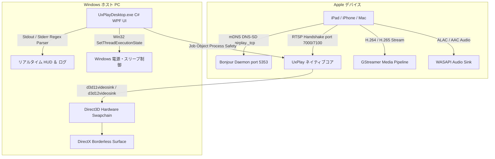

# 📺 UxPlay Desktop (日本語)

  <strong>超低遅延で快適なWindows専用AirPlay画面ミラーリングクライアント</strong> 
  <em>Windows PCを高機能なApple AirPlayレシーバーに変身させ、iPad、iPhone、Macの画面を美しく表示します。</em>

  
  
  
  
  
  

---

### 🌐 他の言語でドキュメントを読む:
[🇪🇸 Español](README.es.md) • [🇺🇸 English](../../README.md) • [🇫🇷 Français](README.fr.md) • [🇩🇪 Deutsch](README.de.md) • [🇮🇹 Italiano](README.it.md) • [🇧🇷 Português (Brasil)](README.pt.md) • [🇷🇺 Русский](README.ru.md) • [🇵🇱 Polski](README.pl.md) • [🇳🇱 Nederlands](README.nl.md) • [🇺🇦 Українська](README.uk.md) • [🇨🇳 简体中文](README.zh-CN.md) • [🇯🇵 日本語](README.ja.md)

---

## ⚡ UxPlay Desktop を選ぶ理由

授業やプレゼン、会議でiPadやiPhoneの画面をPCに映す際、多くのユーザーが以下の問題に悩まされてきました：
- **市販の有料ソフト** は月額サブスクリプションが必要だったり、透かしロゴが画面中央に大きく表示されます。
- **従来のオープンソースツール** は最新のiPadOSで静止画のように固まったり、黒いコマンド画面での入力が必要だったり、音ズレが発生します。

**UxPlay Desktop** はこれらを解消するために開発されました：

- **📦 1クリックで完結する専用インストーラー (`.exe`)：** ZIPファイルの展開は一切不要。セットアップを実行するだけで即座に完了します。
- **🚀 完全自己完結型（Self-Contained）：** .NET 8 ランタイム、C++ ランタイム、GStreamer デコードライブラリを内蔵。追加ダウンロードは不要です。
- **⚡ Direct3D 11/12 ハードウェアアクセラレーション：** 60 FPSの滑らかな描画、GoodNotes等の手書き文字も鮮明に表示し、遅延を感じさせません。
- **🖼️ フレームレスウィンドウ表示：** 画面共有やプロジェクター投影に最適化されたスマートなUI。
- **🛡️ Apple Bonjour＆ファイアウォール自動修復：** mDNSサービスの不具合を自動検出し、Windowsファイアウォールの受信許可ルールを設定します。
- **🌍 15以上の言語に対応：** 日本語、英語、スペイン語、フランス語、ドイツ語、中国語など、瞬時に言語切り替えが可能。
- **🔄 1クリック自動アップデート：** GitHub上の最新版を検知し、ワンクリックで最新状態に更新します。

---

## 📖 クイックスタートガイド（簡単3ステップ）

### ステップ 1: アプリをインストール
1. 最新リリースページから **[`UxPlayDesktop-Setup.exe`](https://github.com/jorjanion/uxplay-desktop/releases/latest)** をダウンロードします。
2. インストーラーを起動し、案内に従って進めます。
3. Bonjourの登録やファイアウォール設定も自動で完了します。

### ステップ 2: AirPlayサーバーを開始
1. **UxPlay Desktop** を起動します。
2. 青色の **「AirPlay サーバーを開始」** ボタンをクリックします。
3. ステータスが青色に変わり **「接続待機中」** と表示されます。

### ステップ 3: iPadまたはiPhoneを接続
1. PCとAppleデバイスが **同一のWi-Fiネットワーク** に接続されていることを確認します。
2. iPadまたはiPhoneで右上からスワイプして **コントロールセンター** を開きます。
3. **画面ミラーリング**（重なる2つの四角形アイコン）をタップします。
4. 一覧から **「UxPlay Windows」** を選択します。
5. 数秒であなたのPC画面に高精細な60 FPSでミラーリングされます！

### ストリーミングプリセット解説
| プリセット | 最適な用途 | 特徴 |
| :--- | :--- | :--- |
| **🎓 授業・プレゼンテーション** *(初期設定)* | 講義、スライド、ホワイトボード手書き | テキストの輪郭を強化し、Direct3D描画とスリープ防止機能を自動発動。 |
| **🎮 低遅延・ゲーム** | スタイラス描画、タッチゲーム | バッファを限界まで縮小し、瞬時の入力応答を実現。 |
| **🎬 高画質シネマ** | 映画、YouTube、動画鑑賞 | ジッターバッファにより映像の途切れやノイズを防止。 |
| **🎵 オーディオ専用** | 音楽、ポッドキャスト、Apple Music | 映像ウィンドウを非表示にして省電力を維持し、可逆ALAC音声を送信。 |

---

## 🛠️ トラブルシューティングとよくある質問

- **iPadの画面ミラーリングに「UxPlay Windows」が表示されない？**
  1. 両方の機器が同じWi-Fiに接続されているか確認してください（クライアント分離機能を持つゲストWi-Fiは不可）。
  2. UxPlay Desktopのメイン画面で **ネットワーク検出 (Apple Bonjour)** を確認し、停止している場合は **「Bonjour を修復 / 開始」** をクリックしてください。

- **映像に対して音声がわずかにズレる？**
  - **設定 > オーディオ設定** に進み、**音声同期遅延** スライダー（例：`+100 ms` や `-100 ms`）を調節してください。

---

## 🔬 技術アーキテクチャと内部設計

技術的な仕組みを理解したい開発者・コントリビューター向けの情報：

### 1. AirPlay プロトコルスタック
* **ベースコード：** [`FDH2/UxPlay`](https://github.com/FDH2/UxPlay) の最新 master ブランチ（v1.74）を採用。
* **FairPlay 暗号化：** RTSP（ポート 7000/7100）を通じてiOS/iPadOS 17/18の暗号化ハンドシェイクを処理。
* **Windows上でのD-Bus排除：** Linux向けD-Busの代わりにWin32 API `SetThreadExecutionState` を直接呼び出し、画面の自動オフを防止。

### 2. GStreamer Direct3D パイプライン
* **Direct3D 11 (`d3d11videosink`)** および Direct3D 12 によるGPUハードウェアデコード。
* パイプライン：`appsrc -> h264parse / h265parse -> d3d11h264dec / d3d11h265dec -> d3d11videosink`。
* ゼロコピーVRAM転送により、CPU使用率を3%未満に抑制。

### 3. Windows Job Object によるプロセスの安全性
* ネイティブサブプロセスは `JOB_OBJECT_LIMIT_KILL_ON_JOB_CLOSE` を設定した Windows **Job Object** に紐付けられています。
* アプリが突然終了しても、OSカーネルがすべての子プロセスを自動回収し、ポートの占有を防ぎます。

### 4. Apple Bonjour サービスの自動修復
* Apple公式の `dnssd.dll` と直接連携。
* 過去の他社ソフトで壊れたレジストリを修復し、`mDNSResponder.exe` を再登録してUDP 5353 / TCP 7000-7100ポートを開放します。

---

## 🐛 バグの報告と Issue の作成

不具合を発見した場合は、ぜひ報告にご協力ください！

**[GitHub Issues](https://github.com/jorjanion/uxplay-desktop/issues)** にて以下の情報を添えて投稿してください：
1. **Windowsのバージョン：** Windows 10 または 11（ビルド番号）。
2. **Apple端末：** 機種名とiPadOS/iOSバージョン。
3. **ログ：** アプリ内の **リアルタイムログ** タブから **「すべてコピー」** して貼り付け。
4. **ネットワーク環境：** 2.4GHz / 5GHz Wi-Fi、有線LANなど。

---

## 🤝 貢献と Pull Request（PR）の歓迎

Pull Request は **大歓迎** です！

開発方針：
1. **確かな価値：** パフォーマンス改善、バグ修正、利便性の向上に寄与する内容であること。
2. **完全無料（0円予算）：** 100% フリー＆オープンソース。有償SDKや外部の有料APIは導入しません。
3. **透明性：** 変更理由と内容をPR本文にわかりやすく記載してください。
4. **テストの合格：** `tests/UxPlayDesktop.Tests` の全自動テストにパスすること。

---

## 📜 ライセンスとクレジット

* **UxPlay Desktop** は **[GNU General Public License v3.0 (GPL-3.0)](LICENSE)** のもとで公開されています。
* **[FDH2/UxPlay](https://github.com/FDH2/UxPlay)** のオープンソース成果に深く感謝します。
* Maintainer: **jorjanion**（愛情を込めて開発・保守中 ❤️）。
