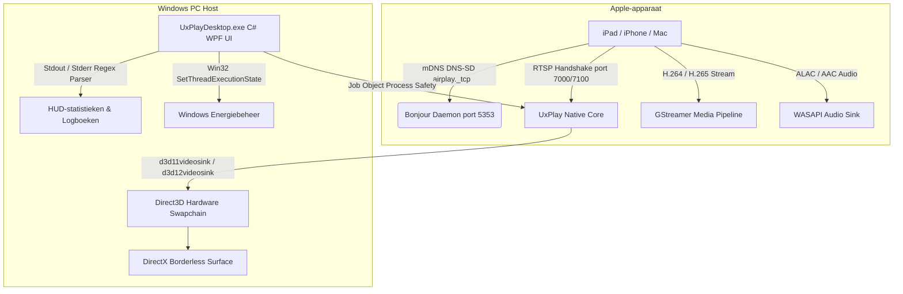

# 📺 UxPlay Desktop (Nederlands)

  <strong>Moderne AirPlay-schermspiegeling met ultralage latentie voor Windows</strong> 
  <em>Verander elke Windows-pc in een krachtige Apple AirPlay-ontvanger voor iPad, iPhone en Mac.</em>

  
  
  
  
  
  

---

### 🌐 Lees deze documentatie in andere talen:
[🇪🇸 Español](README.es.md) • [🇺🇸 English](../../README.md) • [🇫🇷 Français](README.fr.md) • [🇩🇪 Deutsch](README.de.md) • [🇮🇹 Italiano](README.it.md) • [🇧🇷 Português (Brasil)](README.pt.md) • [🇷🇺 Русский](README.ru.md) • [🇵🇱 Polski](README.pl.md) • [🇳🇱 Nederlands](README.nl.md) • [🇺🇦 Українська](README.uk.md) • [🇨🇳 简体中文](README.zh-CN.md) • [🇯🇵 日本語](README.ja.md)

---

## ⚡ Waarom UxPlay Desktop?

Docenten, sprekers en professionals die hun iPad- of iPhone-scherm delen op een pc lopen vaak tegen frustraties aan:
- **Commerciële AirPlay-software** vereist dure abonnementen of toont storende watermerken.
- **Oudere open-source tools** lopen vast bij recente iPadOS-versies, vereisen ingewikkelde consolecommando's of kampen met audio-vertraging.

**UxPlay Desktop** is ontworpen om dit voorgoed op te lossen:

- **📦 Direct installatiebestand (`.exe`):** Geen gedoe met zip-bestanden. Dubbelklik op het installatieprogramma en alles staat klaar.
- **🚀 100% Zelfvoorzienend (Self-Contained):** Geen externe .NET-downloads vereist; .NET 8 runtime, C++ bibliotheken en GStreamer zijn ingebouwd.
- **⚡ Direct3D 11/12 Hardwareversnelling:** Vloeiende 60 FPS weergave, haarscherpe notities en minimale invoervertraging.
- **🖼️ Randloze Venstermodus:** Strakke weergave geoptimaliseerd voor presentaties en schermdeling.
- **🛡️ Automatisch Bonjour- & Firewall-herstel:** Herstelt beschadigde mDNS-services en configureert de Windows Firewall automatisch.
- **🌍 Beschikbaar in 15+ talen:** Nederlands, Engels, Spaans, Frans, Duits, Portugees, Russisch, Chinees, Japans en meer.
- **🔄 1-Klik Updates:** Detecteert automatisch nieuwe GitHub-releases en werkt zichzelf soepel bij.

---

## 📖 Snelstartgids (3 Eenvoudige Stappen)

### Stap 1: Het programma installeren
1. Download het installatiebestand **[`UxPlayDesktop-Setup.exe`](https://github.com/jorjanion/uxplay-desktop/releases/latest)**.
2. Volg de stappen in de installatiewizard.
3. De installer regelt automatisch het Bonjour-beheer en de firewallpoorten.

### Stap 2: De AirPlay-server starten
1. Open **UxPlay Desktop** via het bureaublad of het startmenu.
2. Klik op de blauwe knop **"AirPlay-server Starten"**.
3. De statusindicator wordt blauw: **"Klaar voor verbinding"**.

### Stap 3: Verbind uw iPad of iPhone
1. Zorg dat uw Apple-apparaat en Windows-pc op **hetzelfde wifi-netwerk** zitten.
2. Open het **Bedieningspaneel** op uw iPad of iPhone.
3. Tik op **Synchrone weergave** (het icoon met twee overlappende rechthoeken).
4. Selecteer **"UxPlay Windows"** in de lijst.
5. Uw scherm verschijnt direct in 60 FPS op uw monitor!

### Streamingprofielen en prestaties
| Profiel | Aanbevolen voor | Wat doet het? |
| :--- | :--- | :--- |
| **🎓 Onderwijs & Presentaties** *(Standaard)* | Colleges, dia's, digitale schoolborden | Maximale tekstscherpte, Direct3D en automatische slaapstandblokkering. |
| **🎮 Lage Latentie & Gamen** | Tekenen met stylus, mobiele games | Minimale buffer voor onmiddellijke reactietijd bij 60 FPS. |
| **🎬 Film & HD-Video** | Films, YouTube, videoweergave | Adaptieve buffer tegen haperingen en beeldvervorming. |
| **🎵 Alleen Audio** | Muziek, podcasts, Apple Music | Schakelt video uit om bronnen te sparen en streamt lossless ALAC-audio. |

---

## 🛠️ Veelgestelde Vragen & Probleemoplossing

- **Ziet u "UxPlay Windows" niet in Synchrone Weergave?**
  1. Controleer of beide apparaten op hetzelfde wifi-netwerk zitten (let op gastnetwerken met client-isolatie).
  2. Controleer op het hoofdscherm de kaart **Netwerkdetectie (Apple Bonjour)** en klik zo nodig op **"Bonjour Herstellen / Starten"**.
- **Loopt het geluid niet synchroon met het beeld?**
  - Ga naar **Instellingen > Audio-instellingen** en pas de schuifregelaar **Audio-synchronisatievertraging** aan (bijv. `+100 ms` of `-100 ms`).

---

## 🔬 Technische Architectuur & Werking

Voor ontwikkelaars en geïnteresseerden in de technische werking:

### 1. AirPlay-protocol & Native Core
* **Basis:** Gebaseerd op de master branch van [`FDH2/UxPlay`](https://github.com/FDH2/UxPlay) (v1.74).
* **FairPlay & Handshake:** Handelt RTSP-sleuteluitwisselingen af voor iOS/iPadOS 17/18 (poort 7000/7100).
* **Geen D-Bus op Windows:** Gebruikt de Win32 API `SetThreadExecutionState` om schermvergrendeling tijdens presentaties te voorkomen.

### 2. GStreamer Direct3D Videopijplijn
* Hardwareversnelde decodering via **Direct3D 11 (`d3d11videosink`)** en Direct3D 12.
* Pijplijn: `appsrc -> h264parse / h265parse -> d3d11h264dec / d3d11h265dec -> d3d11videosink`.
* Zero-copy VRAM-weergave met CPU-belasting onder 3%.

### 3. Procesveiligheid via Windows Job Objects
* Native processen zijn gekoppeld aan een Win32 **Job Object** met `JOB_OBJECT_LIMIT_KILL_ON_JOB_CLOSE`.
* Als de interface sluit, beëindigt Windows automatisch alle onderliggende processen.

### 4. Apple Bonjour Zelfherstel
* Directe communicatie met `dnssd.dll`.
* Herstelt foutieve registraties van `mDNSResponder.exe` in `C:\Program Files\Bonjour` en opent UDP 5353 en TCP 7000-7100 in de firewall.

---

## 🐛 Foutmeldingen & Issues

Heeft u een fout ontdekt? Uw melding helpt ons project te verbeteren!

Open een issue op **[GitHub Issues](https://github.com/jorjanion/uxplay-desktop/issues)** met vermelding van:
1. **Windows-versie:** Windows 10 of 11 (buildnummer).
2. **Apple-apparaat:** iPad/iPhone-model en iOS/iPadOS-versie.
3. **Logbestanden:** Kopieer de regels uit het tabblad **Real-time Logboeken**.
4. **Netwerk:** Wi-Fi 2.4/5GHz, kabel of mesh-netwerk.

---

## 🤝 Bijdragen & Pull Requests (PR)

Bijdragen zijn **van harte welkom**!

Uitgangspunten:
1. **Toegevoegde Waarde:** PR's moeten merkbare verbeteringen leveren (prestaties, stabiliteit, toegankelijkheid).
2. **Kostenloos (€0):** Strikt 100% Free & Open Source. Geen betaalde SDK's of propriëtaire onderdelen.
3. **Duidelijkheid:** Licht wijzigingen duidelijk toe in de beschrijving van de PR.
4. **Testdekking:** Alle 39 unittests in `tests/UxPlayDesktop.Tests` moeten slagen.

---

## 📜 Licentie & Erkenningen

* **UxPlay Desktop** is gepubliceerd onder de **[GNU General Public License v3.0 (GPL-3.0)](LICENSE)**.
* Gebouwd op het werk van **[FDH2/UxPlay](https://github.com/FDH2/UxPlay)**.
* Ontwikkeld en onderhouden met ❤️ door **jorjanion**.
