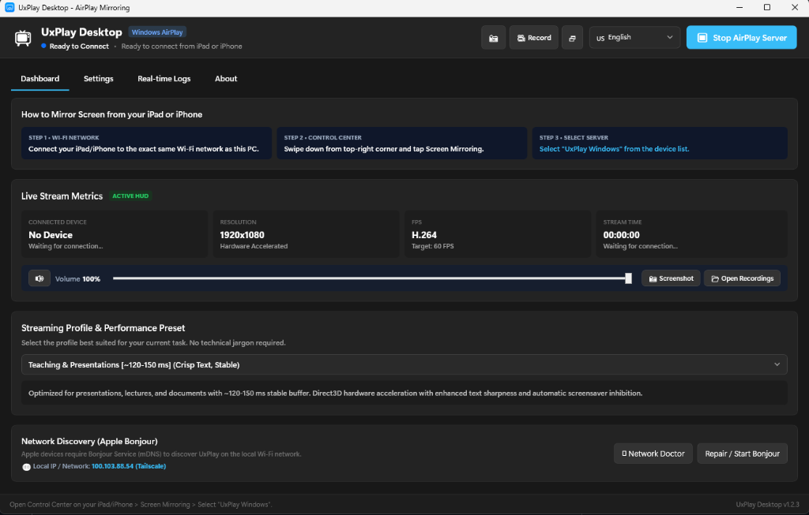
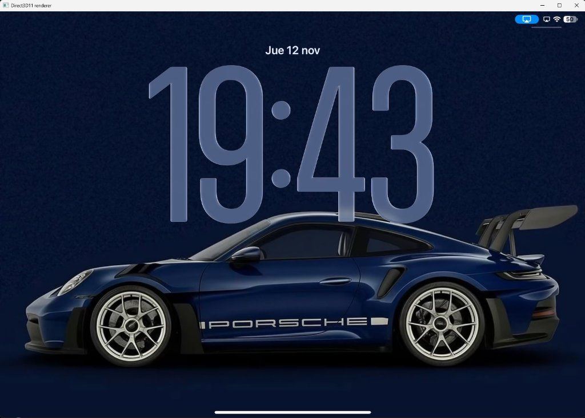

</p>

<p align="center">
  
</p>

<p align="center">
  
</p>

--- 📺 UxPlay Desktop (Polski)

<p align="center">
  <strong>Nowoczesny klient klonowania ekranu AirPlay o ultraniskim opóźnieniu dla systemu Windows</strong><br>
  <em>Zamień dowolny komputer z systemem Windows w wysokowydajny odbiornik Apple AirPlay dla iPada, iPhone'a i komputerów Mac.</em>
</p>

<p align="center">
  <a href="https://github.com/jorjanion/uxplay-desktop/releases/latest"></a>
  <a href="https://github.com/jorjanion/uxplay-desktop/blob/main/LICENSE"></a>
  
  
  
  
</p>

---

### 🌐 Przeczytaj tę dokumentację w innym języku:
[🇪🇸 Español](README.es.md) • [🇺🇸 English](../../README.md) • [🇫🇷 Français](README.fr.md) • [🇩🇪 Deutsch](README.de.md) • [🇮🇹 Italiano](README.it.md) • [🇧🇷 Português (Brasil)](README.pt.md) • [🇷🇺 Русский](README.ru.md) • [🇵🇱 Polski](README.pl.md) • [🇳🇱 Nederlands](README.nl.md) • [🇺🇦 Українська](README.uk.md) • [🇨🇳 简体中文](README.zh-CN.md) • [🇯🇵 日本語](README.ja.md)

---

## âš¡ Dlaczego UxPlay Desktop?

Nauczyciele, wykładowcy i profesjonaliści prezentujący ekran iPada lub iPhone'a często napotykają problemy:
- **Komercyjne programy** wymagają drogich subskrypcji lub nakładają uciążliwe znaki wodne.
- **Starsze narzędzia konsolowe** zawieszają się na nowszych wersjach iPadOS, wymagają wpisywania komend w terminalu lub gubią synchronizację dźwięku.

**UxPlay Desktop** powstał, aby trwale rozwiązać te niedogodności:

- **📦 Natywny Instalator (`.exe`) w 1 Kliknięciu:** Zapomnij o ręcznym wypakowywaniu archiwów ZIP. Uruchom instalator, a aplikacja skonfiguruje wszystko samoczynnie.
- **🚀 100% Niezależny (Self-Contained):** Nie wymaga pobierania zewnętrznych pakietów .NET; zawiera środowisko .NET 8, biblioteki C++ oraz wtyczki GStreamer.
- **⚡ Akceleracja Sprzętowa Direct3D 11/12:** Płynne 60 FPS, krystaliczna ostrość pisma odręcznego i znikome opóźnienia.
- **🖼️ Tryb Okna Bez Ramek:** Przejrzysty widok stworzony z myślą o rzutnikach i transmisjach bez zbędnych pasków.
- **🛡️ Automatyczna Naprawa Usługi Bonjour i Zapory:** Wykrywa uszkodzone usługi mDNS, konfiguruje Apple Bonjour i otwiera reguły w Zaporze Windows.
- **🌍 Obsługa ponad 15 języków:** Polski, angielski, hiszpański, niemiecki, francuski, rosyjski, chiński, japoński i inne.
- **🔄 Automatyczne Aktualizacje:** Wykrywa nowe wydania na GitHubie i aktualizuje się bezpośrednio z poziomu aplikacji.

---

## 📖 Szybki Start (3 Proste Kroki)

### Krok 1: Zainstaluj Program
1. Pobierz instalator **[`UxPlayDesktop-Setup.exe`](https://github.com/jorjanion/uxplay-desktop/releases/latest)**.
2. Uruchom instalator i postępuj zgodnie z instrukcjami na ekranie.
3. Instalator automatycznie skonfiguruje usługę Bonjour i reguły sieciowe zapory.

### Krok 2: Uruchom Serwer AirPlay
1. Uruchom **UxPlay Desktop** z pulpitu lub menu Start.
2. Kliknij niebieski przycisk **"Uruchom Serwer AirPlay"**.
3. Wskaźnik zmieni kolor na niebieski: **"Gotowy do połączenia"**.

### Krok 3: Połącz iPada lub iPhone'a
1. Upewnij się, że komputer i urządzenie Apple są w **tej samej sieci Wi-Fi**.
2. Na iPadzie lub iPhonie otwórz **Centrum sterowania**.
3. Stuknij w **Klonowanie ekranu** (ikona z dwoma nakładającymi się prostokątami).
4. Wybierz z listy pozycjÄ™ **"UxPlay Windows"**.
5. Ekran pojawi się natychmiast na Twoim monitorze w jakości 60 FPS!

### Profile Transmisji i Wydajności
| Profil | Zastosowanie | Działanie |
| :--- | :--- | :--- |
| **🎓 Edukacja i Prezentacje** *(Domyślny)* | Wykłady, slajdy, notatki odręczne | Wzmocniona ostrość tekstu, Direct3D i blokada usypiania ekranu. |
| **🎮 Niskie Opóźnienie i Gry** | Rysowanie rysikiem, gry mobilne | Minimalny bufor dla natychmiastowej reakcji w 60 FPS. |
| **🎬 Kino i Wideo HD** | Filmy, YouTube, multimedia | Adaptacyjny bufor eliminujący zacięcia obrazu. |
| **🎵 Tylko Dźwięk** | Muzyka, podcasty, Apple Music | Wyłącza podgląd wideo, oszczędzając zasoby i przesyłając bezstratny dźwięk ALAC. |

---

## 🛠️ Rozwiązywanie Problemów i FAQ

- **iPad nie widzi "UxPlay Windows" w Klonowaniu Ekranu?**
  1. Sprawdź, czy oba urządzenia są w tej samej sieci Wi-Fi (uwaga na sieci gościnne z izolacją klientów).
  2. W głównym oknie UxPlay Desktop sprawdź kafelek **Wykrywanie w sieci (Apple Bonjour)**. Jeśli usługa jest zatrzymana, kliknij **"Napraw / Uruchom Bonjour"**.
- **Dźwięk ma lekkie opóźnienie względem obrazu?**
  - Przejdź do **Ustawienia > Ustawienia Dźwięku** i wyreguluj suwak **Opóźnienie synchronizacji audio** (np. `+100 ms` lub `-100 ms`).

---

## 🔬 Architektura Techniczna i Budowa Wewnętrzna

Dla programistów i osób zainteresowanych architekturą systemu:

```mermaid
graph TD
    subgraph UrzÄ…dzenie Apple
        A[iPad / iPhone / Mac] -->|mDNS DNS-SD _airplay._tcp| B(Bonjour Daemon port 5353)
        A -->|RTSP Handshake port 7000/7100| C[Natywny Silnik UxPlay Core]
        A -->|H.264 / H.265 Stream| D[GStreamer Media Pipeline]
        A -->|ALAC / AAC Audio| E[WASAPI Audio Sink]
    end

    subgraph Komputer z Windows
        C -->|d3d11videosink / d3d12videosink| F[Direct3D Hardware Swapchain]
        F --> G[DirectX Borderless Surface]
        H[UxPlayDesktop.exe C# WPF UI] -->|Job Object Process Safety| C
        H -->|Stdout / Stderr Regex Parser| I[Metryki HUD & Logi]
        H -->|Win32 SetThreadExecutionState| J[ZarzÄ…dzanie EnergiÄ… Windows]
    end
```

### 1. Stos Protokołu AirPlay i Natywny Silnik
* **Baza:** Kod oparty na gałęzi master [`FDH2/UxPlay`](https://github.com/FDH2/UxPlay) (wersja 1.74).
* **Kryptografia FairPlay:** Obsługa wymiany kluczy w iOS/iPadOS 17/18 przez RTSP (porty 7000/7100).
* **Brak D-Bus w Windows:** Wykorzystanie API Win32 `SetThreadExecutionState` do blokowania wygaszacza ekranu podczas prelekcji.

### 2. Potok Wideo Direct3D GStreamer
* Sprzętowe dekodowanie przez **Direct3D 11 (`d3d11videosink`)** oraz Direct3D 12.
* Potok: `appsrc -> h264parse / h265parse -> d3d11h264dec / d3d11h265dec -> d3d11videosink`.
* Renderowanie zero-copy z użyciem procesora poniżej 3%.

### 3. Bezpieczeństwo Procesów z Windows Job Objects
* Procesy potomne sÄ… przypisane do obiektu **Job Object** z flagÄ… `JOB_OBJECT_LIMIT_KILL_ON_JOB_CLOSE`.
* Zamknięcie interfejsu powoduje natychmiastowe i czyste zamknięcie procesów w tle przez jądro Windows.

### 4. Autonaprawa Usługi Apple Bonjour
* Bezpośrednia komunikacja z biblioteką `dnssd.dll`.
* Naprawia osierocone wpisy `mDNSResponder.exe` w `C:\Program Files\Bonjour` i odblokowuje UDP 5353 oraz TCP 7000-7100 w Zaporze.

---

## 🐛 Zgłaszanie Błędów (Issues)

Znalazłeś błąd? Zgłoszenie pomoże nam ulepszyć aplikację!

Utwórz zgłoszenie na **[GitHub Issues](https://github.com/jorjanion/uxplay-desktop/issues)**, podając:
1. **System operacyjny:** Windows 10 lub 11 (numer kompilacji).
2. **UrzÄ…dzenie Apple:** Model iPada/iPhone'a oraz wersjÄ™ systemu.
3. **Dziennik:** W zakładce **Dziennik w Czasie Rzeczywistym** kliknij **"Kopiuj wszystko"**.
4. **Sieć:** Wi-Fi 2.4/5GHz, kabel LAN lub sieć mesh.

---

## 🤝 Współpraca i Pull Requests (PR)

Pull Requesty sÄ… **bardzo mile widziane**!

Zasady współpracy:
1. **Wymierna Wartość:** Wprowadzane zmiany powinny realnie poprawiać wydajność, stabilność lub ergonomię.
2. **Zerowy Budżet (€0):** Ściśle 100% Free & Open Source. Żadnych płatnych bibliotek czy chmur.
3. **Przejrzystość:** Wyjaśnij w opisie PR cel i powód wprowadzonych zmian.
4. **Kompletność Testów:** Wszystkie testy jednostkowe w `tests/UxPlayDesktop.Tests` muszą zakończyć się sukcesem.

---

## 📜 Licencja i Podziękowania

* **UxPlay Desktop** jest wydany na licencji **[GNU General Public License v3.0 (GPL-3.0)](LICENSE)**.
* Oparty na otwartym silniku stworzonym przez **[FDH2/UxPlay](https://github.com/FDH2/UxPlay)**.
* Opracowany i rozwijany z ❤️ przez **jorjanion**.

