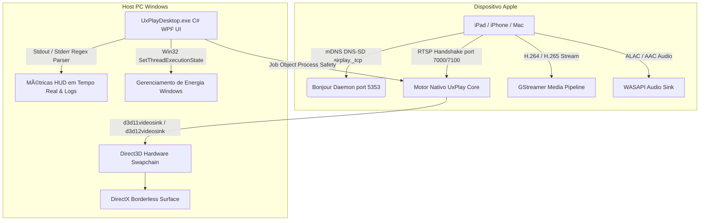

# 📺 UxPlay Desktop (Português - Brasil)

  <strong>Cliente de espelhamento de tela AirPlay moderno e de ultra-baixa latência para Windows</strong> 
  <em>Transforme qualquer computador com Windows em um receptor AirPlay de alta performance para iPad, iPhone e Mac.</em>

  
  
  
  
  
  

---

### 🌐 Ler esta documentação em outros idiomas:
[🇪🇸 Español](README.es.md) • [🇺🇸 English](../../README.md) • [🇫🇷 Français](README.fr.md) • [🇩🇪 Deutsch](README.de.md) • [🇮🇹 Italiano](README.it.md) • [🇧🇷 Português (Brasil)](README.pt.md) • [🇷🇺 Русский](README.ru.md) • [🇵🇱 Polski](README.pl.md) • [🇳🇱 Nederlands](README.nl.md) • [🇺🇦 Українська](README.uk.md) • [🇨🇳 简体中文](README.zh-CN.md) • [🇯🇵 日本語](README.ja.md)

---

## âš¡ Por que escolher o UxPlay Desktop?

Muitos educadores, palestrantes e profissionais que espelham a tela do iPad ou iPhone enfrentam frustrações frequentes:
- **Aplicativos comerciais de AirPlay** cobram assinaturas mensais caras ou exibem marcas d'água irritantes.
- **Ferramentas de código aberto antigas** congelam no primeiro quadro nas versões recentes do iPadOS, exigem comandos difíceis no terminal ou sofrem com atrasos no áudio.

O **UxPlay Desktop** foi projetado para resolver tudo isso em definitivo:

- **📦 Instalador Nativo Direto (`.exe`):** Chega de descompactar arquivos ZIP. Baixe o instalador, avance e o ambiente estará 100% pronto.
- **🚀 100% Autônomo (Self-Contained):** Não exige download externo do .NET; inclui o runtime do .NET 8, DLLs C++ e plugins do GStreamer.
- **⚡ Aceleração Direct3D 11/12 por Hardware:** 60 FPS ultra fluidos, nitidez absoluta no traçado de anotações e latência mínima.
- **🖼️ Modo Janela sem Bordas:** Superfície limpa ideal para projeções e apresentações sem barras ou janelas incômodas.
- **🛡️ Reparo Automático do Bonjour & Firewall:** Detecta serviços corrompidos, reconfigura o Apple Bonjour em um clique e abre as portas no Firewall do Windows.
- **🌍 Disponível em mais de 15 idiomas:** Português, espanhol, inglês, francês, alemão, russo, chinês, japonês e outros.
- **🔄 Atualizações em 1 Clique:** Detecção automática de novas versões e atualização com um clique.

---

## 📖 Guia de Início Rápido (3 Passos Simples)

### Passo 1: Instalar o Programa
1. Baixe o instalador **[`UxPlayDesktop-Setup.exe`](https://github.com/jorjanion/uxplay-desktop/releases/latest)**.
2. Execute a instalação e avance pelas telas do assistente.
3. O instalador configura o programa, o serviço Bonjour e as portas do Firewall do Windows.

### Passo 2: Iniciar o Servidor AirPlay
1. Abra o **UxPlay Desktop** pelo atalho na Área de Trabalho.
2. Clique no botão azul **"Iniciar Servidor AirPlay"**.
3. O indicador ficará azul com a mensagem: **"Pronto para Conectar"**.

### Passo 3: Conectar o iPad ou iPhone
1. Certifique-se de que o PC e o dispositivo Apple estejam na **mesma rede Wi-Fi**.
2. No iPad ou iPhone, abra a **Central de Controle**.
3. Toque em **Espelhar a Tela** (ícone com dois retângulos sobrepostos).
4. Selecione **"UxPlay Windows"** na lista.
5. A tela do seu aparelho aparecerá imediatamente no monitor a 60 FPS sem atrasos.

### Perfis de Transmissão e Desempenho
| Perfil | Recomendado para | O que faz? |
| :--- | :--- | :--- |
| **🎓 Aulas & Apresentações** *(Padrão)* | Aulas, palestras, notas digitais e slides | Máxima nitidez de texto, aceleração Direct3D e bloqueio de protetor de tela para não desligar o monitor. |
| **🎮 Baixa Latência & Jogos** | Desenho com caneta stylus, jogos | Buffer mínimo para resposta imediata a 60 FPS. |
| **🎬 Cinema & Vídeo HD** | Filmes, YouTube, multimídia | Buffer adaptativo contra engasgos para vídeo limpo. |
| **🎵 Apenas Áudio** | Música, podcasts, Apple Music | Desliga o vídeo para economizar recursos e transmite áudio ALAC sem perdas. |

---

## 🛠️ Solução de Problemas e Perguntas Frequentes

- **O iPad não encontra o "UxPlay Windows" no Espelhar Tela?**
  1. Verifique se ambos os aparelhos estão na **mesma rede Wi-Fi** (evite redes de convidados com isolamento de clientes ativado).
  2. No painel principal do UxPlay Desktop, observe o card **Detecção de Rede (Apple Bonjour)**. Se estiver *Parado*, clique em **"Reparar / Iniciar Bonjour"**.
- **O áudio está ligeiramente dessincronizado com o vídeo?**
  - Vá em **Ajustes > Ajustes de Áudio** e ajuste o controle deslizante **Atraso de Sincronização de Áudio** (ex: `+100 ms` ou `-100 ms`).

---

## 🔬 Arquitetura Técnica e Funcionamento Interno

Para desenvolvedores e colaboradores que desejam entender a estrutura técnica:

### 1. Protocolo AirPlay & Núcleo Nativo
* **Origem:** Baseado na master de [`FDH2/UxPlay`](https://github.com/FDH2/UxPlay) (v1.74).
* **Criptografia FairPlay:** Gerencia trocas criptográficas do iOS/iPadOS 17/18 via RTSP (portas 7000/7100).
* **Zero D-Bus no Windows:** Utiliza a API do Windows `SetThreadExecutionState` para impedir suspensão de tela durante apresentações.

### 2. Pipeline de Vídeo Direct3D com GStreamer
* Decodificação acelerada via **Direct3D 11 (`d3d11videosink`)** e Direct3D 12.
* Pipeline: `appsrc -> h264parse / h265parse -> d3d11h264dec / d3d11h265dec -> d3d11videosink`.
* Renderização zero-copy na GPU com uso de CPU inferior a 3%.

### 3. Segurança de Processos com Windows Job Objects
* Processos secundários são associados a um **Job Object** com `JOB_OBJECT_LIMIT_KILL_ON_JOB_CLOSE`.
* Caso a interface seja fechada, o Windows encerra os processos filhos imediatamente, evitando portas bloqueadas.

### 4. Auto-Recuperação do Serviço Apple Bonjour
* Integração direta com a biblioteca `dnssd.dll`.
* Corrige entradas órfãs do `mDNSResponder.exe` em `C:\Program Files\Bonjour` e libera as portas UDP 5353 e TCP 7000-7100 no Firewall.

---

## 🐛 Reportar Erros & Abrir Issues

Encontrou um erro ou falha? Seu relatório nos ajuda a aperfeiçoar o projeto!

Abra uma issue no **[GitHub Issues](https://github.com/jorjanion/uxplay-desktop/issues)** informando:
1. **Sistema Operativo:** Windows 10 ou 11 (número da compilação).
2. **Dispositivo Apple:** Modelo do iPad/iPhone e versão do iOS/iPadOS.
3. **Logs:** Na aba **Logs em Tempo Real**, clique em **"Copiar"** e cole o conteúdo.
4. **Rede:** Wi-Fi 2.4/5GHz, cabo de rede ou repetidor mesh.

---

## 🤝 Como Colaborar & Pull Requests (PRs)

Contribuições são **muito bem-vindas**!

Diretrizes:
1. **Ganho Real:** PRs devem trazer melhorias comprováveis em desempenho, estabilidade ou facilidade de uso.
2. **Orçamento Zero (€0):** Projeto 100% livre e de código aberto. Não serão aceitas dependências proprietárias ou pagas.
3. **Compreensão do Autor:** Explique com clareza as mudanças na descrição da PR para facilitar a revisão.
4. **Testes Unitários:** Todos os testes em `tests/UxPlayDesktop.Tests` devem passar sem erros.

---

## 📜 Licença & Créditos

* **UxPlay Desktop** é distribuído sob a licença **[GNU General Public License v3.0 (GPL-3.0)](LICENSE)**.
* Criado a partir do motor de código aberto de **[FDH2/UxPlay](https://github.com/FDH2/UxPlay)**.
* Desenvolvido e mantido com ❤️ por **jorjanion**.

