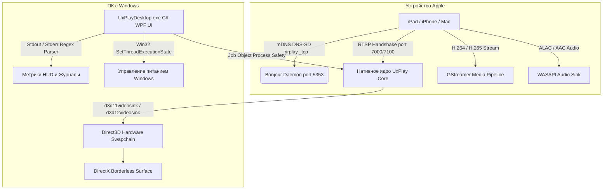

# 📺 UxPlay Desktop (Русский)

  <strong>Современный клиент дублирования экрана AirPlay для Windows с ультранизкой задержкой</strong> 
  <em>Превратите любой компьютер с Windows в высокопроизводительный приемник Apple AirPlay для iPad, iPhone и Mac.</em>

  
  
  
  
  
  

---

### 🌐 Читать эту документацию на других языках:
[🇪🇸 Español](README.es.md) • [🇺🇸 English](../../README.md) • [🇫🇷 Français](README.fr.md) • [🇩🇪 Deutsch](README.de.md) • [🇮🇹 Italiano](README.it.md) • [🇧🇷 Português (Brasil)](README.pt.md) • [🇷🇺 Русский](README.ru.md) • [🇵🇱 Polski](README.pl.md) • [🇳🇱 Nederlands](README.nl.md) • [🇺🇦 Українська](README.uk.md) • [🇨🇳 简体中文](README.zh-CN.md) • [🇯🇵 日本語](README.ja.md)

---

## ⚡ Почему UxPlay Desktop?

Преподаватели, лекторы и специалисты часто сталкиваются со сложностями при дублировании экрана Apple на Windows:
- **Коммерческие программы** требуют регулярных дорогих подписок или накладывают водяные знаки.
- **Устаревшие консольные утилиты** зависают на первом кадре в свежих версиях iPadOS, требуют ручного ввода команд в терминале или страдают от рассинхронизации звука.

**UxPlay Desktop** создан для надежного и простого решения всех этих задач:

- **📦 Нативный инсталлятор (.exe) в 1 клик:** Никаких ручных распаковок ZIP-архивов. Запустите установку, и всё настроится автоматически.
- **🚀 100% Автономность (Self-Contained):** Не требует скачивания .NET; внутри уже есть среда .NET 8, библиотеки C++ и плагины GStreamer.
- **⚡ Аппаратное ускорение Direct3D 11/12:** Плавные 60 FPS, безупречная четкость рукописного текста и минимальная задержка.
- **🖼️ Безрамочный оконный режим:** Чистое отображение без лишних панелей для демонстраций и трансляций.
- **🛡️ Автоматическое исправление Bonjour и Брандмауэра:** Обнаруживает неработающие службы mDNS, настраивает Apple Bonjour и открывает порты в Брандмауэре Windows.
- **🌍 Интерфейс на более чем 15 языках:** Русский, английский, испанский, французский, немецкий, китайский, японский и другие с мгновенным переключением.
- **🔄 Обновления в 1 клик:** Автоматическое обнаружение релизов на GitHub и обновление в один клик.

---

## 📖 Краткое Руководство (3 Простых Шага)

### Шаг 1: Установка Программы
1. Скачайте инсталлятор **[`UxPlayDesktop-Setup.exe`](https://github.com/jorjanion/uxplay-desktop/releases/latest)** из последнего релиза.
2. Запустите установку и следуйте подсказкам мастера.
3. Программа автоматически установит приложение, зарегистрирует службу Bonjour и настроит правила сети.

### Шаг 2: Запуск Сервера AirPlay
1. Запустите **UxPlay Desktop** с Рабочего стола или меню Пуск.
2. Нажмите синюю кнопку **"Запустить Сервер AirPlay"**.
3. Индикатор станет синим со статусом: **"Готов к подключению"**.

### Шаг 3: Подключение iPad или iPhone
1. Убедитесь, что ПК и устройство Apple подключены к **одной сети Wi-Fi**.
2. На iPad или iPhone откройте **Пункт управления**.
3. Нажмите **Повтор экрана** (значок с двумя прямоугольниками).
4. Выберите **"UxPlay Windows"** в списке.
5. Экран мгновенно отобразится на мониторе в разрешении 60 FPS.

### Профили Трансляции и Производительности
| Профиль | Для чего подходит | Описание |
| :--- | :--- | :--- |
| **🎓 Обучение и Презентации** *(По умолчанию)* | Лекции, слайды, заметки и презентации | Максимальная четкость текста, Direct3D и запрет ухода монитора в спящий режим. |
| **🎮 Минимальная Задержка и Игры** | Рисование стилусом, мобильные игры | Минимальный буфер для мгновенного отклика при 60 FPS. |
| **🎬 Кино и HD-Видео** | Фильмы, YouTube, видеопотоки | Адаптивный буфер устраняет подергивания и артефакты сжатия. |
| **🎵 Только Аудио** | Музыка, подкасты, Apple Music | Отключает видеоокно для экономии ресурсов и передает звук ALAC без потерь. |

---

## 🛠️ Решение Проблем и Частые Вопросы

- **iPad не видит "UxPlay Windows" в Повторе экрана?**
  1. Убедитесь, что оба устройства находятся в **одной сети Wi-Fi** (в гостевых сетях часто включена изоляция клиентов).
  2. На главной вкладке UxPlay Desktop проверьте карточку **Обнаружение в сети (Apple Bonjour)**. Если статус *Остановлен*, нажмите кнопку **"Восстановить / Запустить Bonjour"**.
- **Звук немного отстает от видео?**
  - Откройте **Настройки > Настройки Аудио** и отрегулируйте ползунок **Задержка синхронизации звука** (например, `+100 мс` или `-100 мс`).

---

## 🔬 Техническая Архитектура и Внутреннее Устройство

Для разработчиков, желающих разобраться в архитектуре проекта:

### 1. Протокол AirPlay и Нативное Ядро
* **Основа:** Ветка master репозитория [`FDH2/UxPlay`](https://github.com/FDH2/UxPlay) (версия 1.74).
* **Криптография FairPlay:** Поддержка обмена ключами в iOS/iPadOS 17/18 через RTSP (порты 7000/7100).
* **Без D-Bus на Windows:** Вместо Linux D-Bus используется нативный вызов `SetThreadExecutionState` для предотвращения сна экрана.

### 2. Видеоконвейер GStreamer Direct3D
* Аппаратное декодирование через **Direct3D 11 (`d3d11videosink`)** и Direct3D 12.
* Конвейер: `appsrc -> h264parse / h265parse -> d3d11h264dec / d3d11h265dec -> d3d11videosink`.
* Рендеринг zero-copy с нагрузкой на процессор менее 3%.

### 3. Безопасность Процессов через Windows Job Objects
* Подпроцессы привязаны к объекту **Job Object** с параметром `JOB_OBJECT_LIMIT_KILL_ON_JOB_CLOSE`.
* При закрытии окна Windows автоматически завершает все дочерние процессы, не оставляя зависших портов.

### 4. Автовосстановление Apple Bonjour
* Прямое взаимодействие с библиотекой `dnssd.dll`.
* Восстанавливает поврежденные регистрации `mDNSResponder.exe` в `C:\Program Files\Bonjour` и открывает UDP 5353 и TCP 7000-7100 в Брандмауэре.

---

## 🐛 Сообщение об Ошибках и Создание Issue

Нашли ошибку? Будем рады вашему отчету!

Создайте тему на **[GitHub Issues](https://github.com/jorjanion/uxplay-desktop/issues)**, указав:
1. **Операционная система:** Windows 10 или 11 (номер сборки).
2. **Устройство Apple:** Модель iPad/iPhone и версия iOS/iPadOS.
3. **Журнал:** Во вкладке **Журнал в реальном времени** нажмите **"Копировать"** и приложите лог.
4. **Сеть:** Wi-Fi 2.4/5 ГГц, кабель или mesh-роутер.

---

## 🤝 Участие в Разработке и Pull Requests

Мы рады предложениям и Pull Requests!

Требования к коду:
1. **Реальная польза:** PR должен нести измеримое улучшение (производительность, стабильность, удобство).
2. **Нулевой бюджет (0 €):** Исключительно 100% Free & Open Source. Никаких платных библиотек.
3. **Понятность:** Подробно опишите внесенные изменения в описании PR.
4. **Прохождение тестов:** Все 39 тестов в `tests/UxPlayDesktop.Tests` должны проходить успешно.

---

## 📜 Лицензия и Благодарности

* **UxPlay Desktop** распространяется под лицензией **[GNU General Public License v3.0 (GPL-3.0)](LICENSE)**.
* Создано на базе открытого ядра **[FDH2/UxPlay](https://github.com/FDH2/UxPlay)**.
* Разработано и поддерживается с ❤️ автором **jorjanion**.
