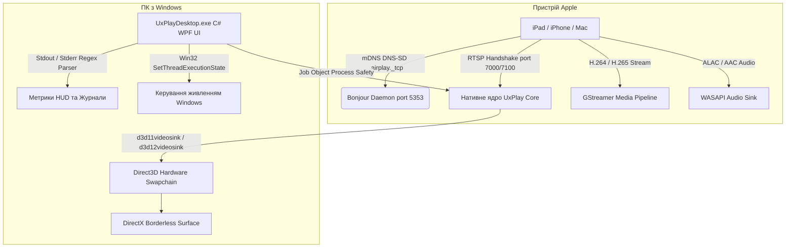

# 📺 UxPlay Desktop (Українська)

  <strong>Сучасний клієнт дублювання екрана AirPlay для Windows із наднизькою затримкою</strong> 
  <em>Перетворіть будь-який ПК з Windows на високопродуктивний приймач Apple AirPlay для iPad, iPhone та Mac.</em>

  
  
  
  
  
  

---

### 🌐 Читати цю документацію іншими мовами:
[🇪🇸 Español](README.es.md) • [🇺🇸 English](../../README.md) • [🇫🇷 Français](README.fr.md) • [🇩🇪 Deutsch](README.de.md) • [🇮🇹 Italiano](README.it.md) • [🇧🇷 Português (Brasil)](README.pt.md) • [🇷🇺 Русский](README.ru.md) • [🇵🇱 Polski](README.pl.md) • [🇳🇱 Nederlands](README.nl.md) • [🇺🇦 Українська](README.uk.md) • [🇨🇳 简体中文](README.zh-CN.md) • [🇯🇵 日本語](README.ja.md)

---

## ⚡ Чому саме UxPlay Desktop?

Викладачі, лектори та фахівці часто стикаються з незручностями під час трансляції екрана з Apple на Windows:
- **Комерційні аналоги** вимагають регулярних передплат або додають водяні знаки на зображення.
- **Застарілі консольні інструменти** зависають у нових версіях iPadOS, потребують ручного введення команд або мають проблеми із розсинхронізацією звуку.

**UxPlay Desktop** створений для комфортного та надійного вирішення цих завдань:

- **📦 Нативний інсталятор (.exe) в 1 клік:** Жодної мороки з архівами ZIP. Запустіть встановлення, і програма зробить усе автоматично.
- **🚀 100% Автономність (Self-Contained):** Не потребує завантаження зовнішнього .NET; середовище .NET 8, модулі C++ та плагіни GStreamer уже вбудовано.
- **⚡ Апаратне прискорення Direct3D 11/12:** Плавні 60 FPS, бездоганна чіткість рукописних нотаток та мінімальна затримка.
- **🖼️ Безрамковий віконний режим:** Чисте зображення без зайвих панелей для презентацій та запису екрана.
- **🛡️ Автоматичне відновлення Bonjour та Брандмауера:** Виправляє пошкоджені служби mDNS та відкриває потрібні мережеві порти.
- **🌍 Інтерфейс понад 15 мовами:** Українська, англійська, іспанська, французька, німецька, польська, японська тощо з миттєвим перемиканням.
- **🔄 Оновлення в 1 клік:** Автоматично перевіряє нові релізи на GitHub та оновлюється в один клік.

---

## 📖 Швидкий Старт (3 Прості Кроки)

### Крок 1: Встановлення Програми
1. Завантажте інсталятор **[`UxPlayDesktop-Setup.exe`](https://github.com/jorjanion/uxplay-desktop/releases/latest)** з останнього релізу.
2. Запустіть встановлення та дотримуйтесь інструкцій майстра.
3. Інсталятор налаштує програму, службу Bonjour та правила брандмауера.

### Крок 2: Запуск Сервера AirPlay
1. Запустіть **UxPlay Desktop** з Робочого столу або меню Пуск.
2. Натисніть синю кнопку **"Запустити Сервер AirPlay"**.
3. Індикатор стане синім: **"Готовий до підключення"**.

### Крок 3: Підключення iPad або iPhone
1. Переконайтеся, що комп'ютер та пристрій Apple у **одній мережі Wi-Fi**.
2. На iPad або iPhone відкрийте **Центр керування**.
3. Торкніться **Дублювання екрана** (значок з двома прямокутниками).
4. Оберіть **"UxPlay Windows"** у списку.
5. Екран миттєво з'явиться на моніторі з плавними 60 FPS!

### Профілі Трансляції та Продуктивність
| Профіль | Рекомендовано для | Опис |
| :--- | :--- | :--- |
| **🎓 Навчання та Презентації** *(За замовчуванням)* | Лекції, слайди, цифрова дошка | Максимальна чіткість тексту, Direct3D та заборона переходу монітора в режим сну. |
| **🎮 Низька Затримка та Ігри** | Малювання стилусом, мобільні ігри | Мінімальний буфер для миттєвого відгуку в 60 FPS. |
| **🎬 Кіно та HD-Відео** | Фільми, YouTube, відеопотоки | Адаптивний буфер усуває посмикування кадрів. |
| **🎵 Тільки Аудіо** | Музика, подкасти, Apple Music | Вимикає відео для заощадження ресурсів та передає звук без втрат ALAC. |

---

## 🛠️ Усунення Неполадок та Часті Питання

- **iPad не бачить "UxPlay Windows" у Дублюванні Екрана?**
  1. Перевірте, чи обидва пристрої в одній мережі Wi-Fi (у гостьових мережах часто ввімкнено ізоляцію клієнтів).
  2. На головному екрані UxPlay Desktop перевірте блок **Виявлення в мережі (Apple Bonjour)**. Якщо службу зупинено, натисніть **"Відновити / Запустити Bonjour"**.
- **Звук трохи відстає від відео?**
  - Перейдіть у **Налаштування > Налаштування Аудіо** та відрегулюйте повзунок **Затримка синхронізації звуку** (наприклад, `+100 мс` або `-100 мс`).

---

## 🔬 Технічна Архітектура та Внутрішній Устрій

Для розробників, які бажають розібратися в архітектурі проєкту:

### 1. Стек Протоколу AirPlay та Нативне Ядро
* **Основа:** Гілка master репозиторію [`FDH2/UxPlay`](https://github.com/FDH2/UxPlay) (версія 1.74).
* **Криптографія FairPlay:** Обмін ключами в iOS/iPadOS 17/18 через RTSP (порти 7000/7100).
* **Без D-Bus на Windows:** Використання нативного виклику `SetThreadExecutionState` для запобігання блокуванню екрана під час доповідей.

### 2. Відеоконвеєр GStreamer Direct3D
* Апаратне декодування через **Direct3D 11 (`d3d11videosink`)** та Direct3D 12.
* Конвеєр: `appsrc -> h264parse / h265parse -> d3d11h264dec / d3d11h265dec -> d3d11videosink`.
* Рендеринг zero-copy з навантаженням на процесор менше 3%.

### 3. Безпека Процесів через Windows Job Objects
* Підпроцеси закріплено за об'єктом **Job Object** із прапорцем `JOB_OBJECT_LIMIT_KILL_ON_JOB_CLOSE`.
* У разі закриття інтерфейсу ядро Windows автоматично вимикає всі дочірні процеси.

### 4. Самовідновлення Apple Bonjour
* Пряма взаємодія з бібліотекою `dnssd.dll`.
* Відновлює пошкоджені записи `mDNSResponder.exe` у `C:\Program Files\Bonjour` та налаштовує порти UDP 5353 і TCP 7000-7100 у Брандмауері.

---

## 🐛 Звіти про Помилки (Issues)

Знайшли помилку? Ваше повідомлення допоможе нам покращити проєкт!

Створіть звернення на **[GitHub Issues](https://github.com/jorjanion/uxplay-desktop/issues)**, вказавши:
1. **Версія Windows:** Windows 10 або 11 (номер збірки).
2. **Пристрій Apple:** Модель iPad/iPhone та версія iOS/iPadOS.
3. **Журнал:** У вкладці **Журнал у реальному часі** натисніть **"Копіювати"**.
4. **Мережа:** Wi-Fi 2.4/5 ГГц, мережевий кабель або mesh-роутер.

---

## 🤝 Участь у Розробці та Pull Requests

Ми раді пропозиціям та Pull Requests!

Вимоги до коду:
1. **Реальна користь:** PR повинен нести вимірне покращення (продуктивність, стабільність, доступність).
2. **Нульовий бюджет (0 €):** Виключно 100% Free & Open Source. Жодних платних SDK чи хмарних сервісів.
3. **Зрозумілість:** Опишіть внесені зміни в описі PR для зручності перевірки.
4. **Проходження тестів:** Усі 39 тестів у `tests/UxPlayDesktop.Tests` мають завершуватися успішно.

---

## 📜 Ліцензія та Подяки

* **UxPlay Desktop** розповсюджується за ліцензією **[GNU General Public License v3.0 (GPL-3.0)](LICENSE)**.
* Створено на основі відкритого ядра **[FDH2/UxPlay](https://github.com/FDH2/UxPlay)**.
* Розроблено та підтримується з ❤️ автором **jorjanion**.
