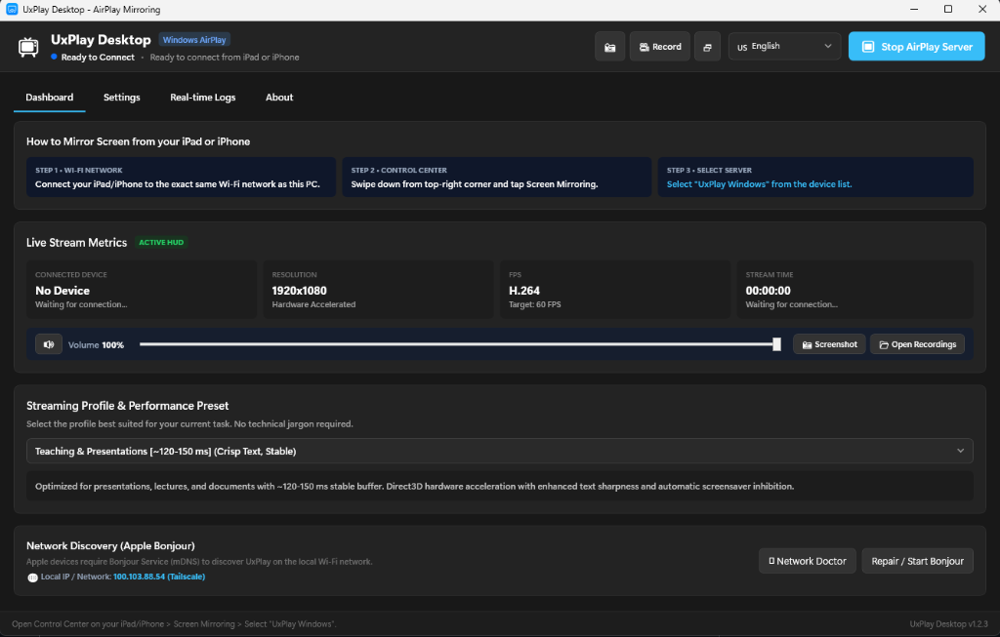
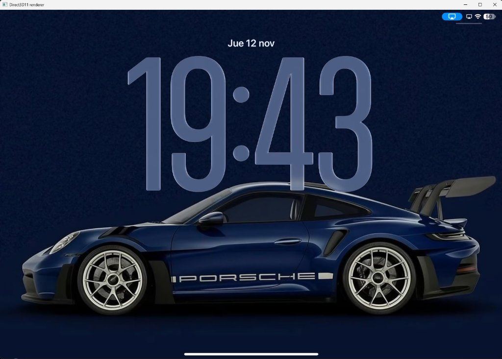

</p>

<p align="center">
  
</p>

<p align="center">
  
</p>

--- 📺 UxPlay Desktop (简体中文)

<p align="center">
  <strong>专为 Windows 打造的超低延迟现代化 AirPlay 屏幕镜像客户端</strong><br>
  <em>将任何 Windows 电脑秒变高性能 Apple AirPlay 接收端，完美支持 iPad、iPhone 与 Mac。</em>
</p>

<p align="center">
  <a href="https://github.com/jorjanion/uxplay-desktop/releases/latest"></a>
  <a href="https://github.com/jorjanion/uxplay-desktop/blob/main/LICENSE"></a>
  
  
  
  
</p>

---

### 🌐 在其他语言中阅读此文档:
[🇪🇸 Español](README.es.md) • [🇺🇸 English](../../README.md) • [🇫🇷 Français](README.fr.md) • [🇩🇪 Deutsch](README.de.md) • [🇮🇹 Italiano](README.it.md) • [🇧🇷 Português (Brasil)](README.pt.md) • [🇷🇺 Русский](README.ru.md) • [🇵🇱 Polski](README.pl.md) • [🇳🇱 Nederlands](README.nl.md) • [🇺🇦 Українська](README.uk.md) • [🇨🇳 简体中文](README.zh-CN.md) • [🇯🇵 日本語](README.ja.md)

---

## ⚡ 为什么选择 UxPlay Desktop？

许多在演讲、课堂和会议中需要将 iPad 或 iPhone 投屏到电脑的用户经常遇到以下痛点：
- **商业投屏软件** 收费高昂、按月订阅，或在屏幕中央强制显示碍眼的水印。
- **旧版开源命令行工具** 在新版 iPadOS 下画面首帧冻结、需要手动输入复杂黑框命令、声音画面不同步或缺少运行库报错崩溃。

**UxPlay Desktop** 专为彻底解决这些问题而设计：

- **📦 原生安装包 (`.exe`) 一键部署：** 无需手动解压繁琐的压缩包。点击下一步即可自动配置全部运行环境。
- **🚀 100% 独立内置 (Self-Contained)：** 无需另外下载 .NET 环境；已完整集成 .NET 8 桌面运行时、C++ 运行库以及 GStreamer 解码插件。
- **⚡ Direct3D 11/12 硬件加速渲染：** 极速 60 FPS 流畅体验，笔记手写笔迹超清晰，超低输入延迟。
- **🖼️ 无边框全屏沉浸模式：** 界面干净优雅，专为投屏展示与录屏优化，无杂乱边框干扰。
- **🛡️ 自动修复 Bonjour 与防火墙：** 自动检测受损的 mDNS 服务，一键修复 Apple Bonjour 并开启 Windows 防火墙所需端口。
- **🌍 支持 15+ 种语言：** 简体中文、英文、西班牙语、法语、德语、日语等多国语言，实时无缝切换。
- **🔄 软件内一键自动更新：** 自动检测 GitHub 最新发布版本，单击即可自动下载更新并重启。

---

## 📖 快速上手指南（仅需 3 步）

### 第 1 步：安装软件
1. 从最新发布页下载 **[`UxPlayDesktop-Setup.exe`](https://github.com/jorjanion/uxplay-desktop/releases/latest)** 安装程序。
2. 运行安装向导并完成安装。
3. 安装程序会自动部署程序、配置 Apple Bonjour 服务并设置防火墙白名单。

### 第 2 步：启动 AirPlay 服务
1. 从桌面或开始菜单启动 **UxPlay Desktop**。
2. 点击大蓝色按钮 **"启动 AirPlay 服务"**。
3. 状态指示灯变蓝并提示：**"等待设备连接"**。

### 第 3 步：在 iPad 或 iPhone 上连接
1. 确保电脑与 Apple 设备处于 **同一个 Wi-Fi 局域网**。
2. 在 iPad 或 iPhone 上滑下控制中心。
3. 点击 **屏幕镜像** 图标（两个重叠矩形）。
4. 在列表中选择 **"UxPlay Windows"**。
5. 您的设备画面将立即以 60 FPS 超清呈现在 Windows 显示器上！

### 串流预设与性能模式详解
| 预设模式 | 适用场景 | 功能特点 |
| :--- | :--- | :--- |
| **🎓 教学与演讲** *(默认)* | 授课、幻灯片、课堂板书笔记 | 文字锐度强化、Direct3D 加速并自动阻止屏幕休眠。 |
| **🎮 低延迟与游戏** | 手写笔绘图、移动游戏即时操作 | 极致减少缓冲，达到触控即时响应。 |
| **🎬 高清影音** | 电影、Bilibili、YouTube 视频播放 | 自适应抖动缓冲，杜绝画面卡顿与撕裂。 |
| **🎵 仅音频模式** | 播客、Apple Music 音乐串流 | 关闭视频画面节省系统资源，传输 ALAC 无损高保真音频。 |

---

## 🛠️ 常见问题与故障排查

- **iPad 屏幕镜像中找不到 "UxPlay Windows"？**
  1. 请检查电脑与移动设备是否连在同一 Wi-Fi（注意避免开启访客网络设备隔离）。
  2. 在 UxPlay Desktop 主界面中查看 **网络发现 (Apple Bonjour)** 卡片，若显示已停止，点击 **"修复 / 启动 Bonjour"**。

- **声音和画面存在轻微不同步？**
  - 进入 **设置 > 音频设置**，滑动调节 **音频同步校准** 滑块（如 `+100 ms` 或 `-100 ms`）即可消除蓝牙耳机延迟。

---

## 🔬 技术架构与内部实现原理

供希望深入了解底层设计的开发者与贡献者参考：

```mermaid
graph TD
    subgraph Apple 移动设备
        A[iPad / iPhone / Mac] -->|mDNS DNS-SD _airplay._tcp| B(Bonjour Daemon port 5353)
        A -->|RTSP Handshake port 7000/7100| C[UxPlay C 原生底层核心]
        A -->|H.264 / H.265 Stream| D[GStreamer Media Pipeline]
        A -->|ALAC / AAC Audio| E[WASAPI Audio Sink]
    end

    subgraph Windows 主机端
        C -->|d3d11videosink / d3d12videosink| F[Direct3D Hardware Swapchain]
        F --> G[DirectX Borderless Surface]
        H[UxPlayDesktop.exe C# WPF UI] -->|Job Object Process Safety| C
        H -->|Stdout / Stderr Regex Parser| I[实时 HUD 状态与日志]
        H -->|Win32 SetThreadExecutionState| J[Windows 电源休眠控制]
    end
```

### 1. AirPlay 协议栈与原生核心
* **代码基础：** 基于 upstream master 分支 [`FDH2/UxPlay`](https://github.com/FDH2/UxPlay) (v1.74)。
* **FairPlay 握手交互：** 通过 RTSP（端口 7000/7100）处理现代 iOS/iPadOS 复杂密钥协商。
* **Windows 平台零 D-Bus：** 移除 Linux D-Bus 依赖，改用 Win32 API `SetThreadExecutionState` 阻止演示过程中屏幕变暗。

### 2. GStreamer Direct3D 视频管线
* 采用 GPU 硬件加速解码：**Direct3D 11 (`d3d11videosink`)** 与 Direct3D 12。
* 解码管线：`appsrc -> h264parse / h265parse -> d3d11h264dec / d3d11h265dec -> d3d11videosink`。
* 零拷贝显存传输，现代多核 CPU 占用率低于 3%。

### 3. 基于 Windows Job Objects 的进程安全保障
* 原生子进程被绑定至 Windows **Job Object**，赋予 `JOB_OBJECT_LIMIT_KILL_ON_JOB_CLOSE` 属性。
* 当界面异常关闭时，操作系统内核自动清理全部子进程，杜绝端口占用与僵尸进程。

### 4. Apple Bonjour 服务自动诊断与恢复
* 动态链接 Apple 原生 `dnssd.dll`。
* 若先前的第三方软件残留损坏服务，程序将自动以管理员身份重建 `mDNSResponder.exe` 服务并开放网络端口。

---

## 🐛 提交缺陷与提出建议 (Issues)

遇到异常或连接问题？欢迎反馈！

请在 **[GitHub Issues](https://github.com/jorjanion/uxplay-desktop/issues)** 提交反馈，并提供：
1. **系统版本：** Windows 10 或 11 具体内部版本号。
2. **Apple 设备：** iPad/iPhone 型号及系统版本。
3. **运行日志：** 打开软件 **实时日志** 选项卡，点击 **"复制全部"** 并粘贴关键片段。
4. **网络拓扑：** 2.4G/5G Wi-Fi、有线网卡或 Mesh 组网。

---

## 🤝 贡献指南与 Pull Requests

热烈欢迎社区贡献！

协作准则：
1. **切实价值：** 提交的代码需带来性能提升、错误修复或体验改善。
2. **零成本原则 (€0)：** 坚守完全开源与免费原则，严禁引入闭源商业 SDK 或付费云服务。
3. **清晰可读：** 在 PR 中清晰说明修改内容与原因，确保维护者能顺畅理解每一行改动。
4. **测试健全：** 必须通过 `tests/UxPlayDesktop.Tests` 单元测试套件全部测试。

---

## 📜 开源协议与致谢

* **UxPlay Desktop** 采用 **[GNU 通用公共许可证 v3.0 (GPL-3.0)](LICENSE)** 协议开源发布。
* 核心基于 **[FDH2/UxPlay](https://github.com/FDH2/UxPlay)** 优秀的逆向工程成果。
* 由 **jorjanion** 用 ❤️ 开发与用心维护。

